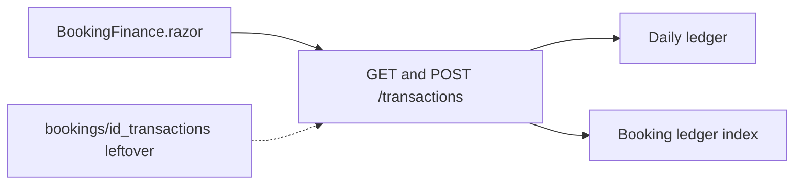

# Finish the booking transaction projection

## Where the branch stands

This working tree is the Blazor line: [src/HotelDruid.Api](src/HotelDruid.Api) (minimal APIs, file storage), [src/HotelDruid.Client](src/HotelDruid.Client) (Blazor UI), [src/HotelDruid.Shared](src/HotelDruid.Shared) (DTOs), plus API/client tests and [tools/HotelDruid.Migration](tools/HotelDruid.Migration). The PHP predecessor stays on `main` and is out of scope for this step.

The checked items in [docs/ledger-parity-todo.md](docs/ledger-parity-todo.md) match the code. Payments, deposits, refunds, stay charges, prepaid changes, expenses, and petty cash all go through [FinancialPostingService](src/HotelDruid.Api/Services/IFinancialPostingService.cs) into the daily ledger. Booking finance and the general ledger page already read that ledger. The small chart of accounts and the ledger API tests are in place.

The first open item is only partly done:

- `POST /api/bookings/{year}/{id}/transactions` writes a balanced journal and appends the debit line id to [BookingLedgerIndexRepository](src/HotelDruid.Api/Services/BookingLedgerIndexRepository.cs). It does not write `bookings/{id}_transactions/`.
- `GET` the same path already builds `BookingTransactionDto` rows from ledger lines, index first, stay-date scan second.
- [BookingTransactionRepository](src/HotelDruid.Api/Services/BookingTransactionRepository.cs) is not registered in DI. It is leftover, with its interface, models, and [BookingTransactionRepositoryTests](tests/HotelDruid.Api.Tests/Services/BookingTransactionRepositoryTests.cs).
- [ARCHITECTURE.md](ARCHITECTURE.md) still documents that folder as a second ledger.

The booking-index checkbox (the item after this one) is already started: `_ledger_index.json` exists and is the fast read path. This step keeps that path and does not expand it.

## What is wrong with the current projection

The finance page in [BookingFinance.razor](src/HotelDruid.Client/Pages/BookingFinance.razor) is already the right screen: Bootstrap `bookings-manager` panels, localized labels, list on the left, transaction history in the middle, totals on the right. No layout change.

The API projection does not feed that screen faithfully:

- `SourceId` is `DateTime.UtcNow.Ticks`. The list parses that into an `int`, which fails, so every row comes back as sequence `0`. The page sorts and selects by sequence, so two payments cannot be told apart.
- `AppliedTo` and `CreatedBy` are accepted on write and then returned as null. The detail grid already renders Applied to, and it will always show `-`.
- A journal is two lines. The index stores only the debit line, so the indexed path shows one row. The date-range fallback, and [DocumentRenderService](src/HotelDruid.Api/Services/DocumentRenderService.cs), walk both lines and will double the payment on the list, the finance totals, and the invoice.

`LedgerEntry` has no applied-to field. Persist it on the entry (same style as `CreatedBy` and `CashRegisterId`) and pass it through `PostBalancedAsync`. Do not overload `Method`, which is the payment-method slot for a later checklist item.

## Implementation

Keep the existing write and read shape. Extract one projection used by the transaction list, the finance summary, and document rendering:

- Keep only lines with `SourceType == "booking-transaction"`.
- Collapse each `JournalId` to one business event. Amount is the non-zero side of that journal, once.
- Order by timestamp, then journal id, and assign sequence `1..n` on read. Return that same shape from `POST`, including applied-to and created-by.
- Read path stays index-first, then `GetEntriesForBookingAsync` for bookings that have no index yet. Grouping makes the fallback safe when both sides of the journal are present.

Delete the unused second book and the helpers in [Program.cs](src/HotelDruid.Api/Program.cs) that only exist for it (`ToBookingTransactionDto`, `IsDepositTransaction`, `IsPaymentTransaction`). Keep [BookingTransactionDto](src/HotelDruid.Shared/Dtos.cs) and `BookingTransactionWriteDto`; those are the API the page already calls.

Leave [BookingFinance.razor](src/HotelDruid.Client/Pages/BookingFinance.razor) and its service as they are. A correct sequence, applied-to, and created-by on the existing DTO is what the current markup expects.

Replace `BookingTransactionRepositoryTests` with an API test next to [LedgerApiTests](tests/HotelDruid.Api.Tests/Integration/LedgerApiTests.cs): one payment creates no `{bookingId}_transactions` folder, `GET /transactions` returns one row, sequence is unique across two posts, applied-to and created-by round-trip, and the general-ledger query still returns the balanced pair.

Update [ARCHITECTURE.md](ARCHITECTURE.md) so section 10 describes the ledger projection and the booking ledger index, and drop the `{bookingId}_transactions` store. In [docs/ledger-parity-todo.md](docs/ledger-parity-todo.md), tick the Blazor half of this item and add a separate unchecked item for the PHP `main` branch: after this screen is visually checked, update PHP export/import so it does not keep a second per-booking transaction book. Do not change PHP in this step.

The next open coding item after that remains the booking index, which is already the fast path and should not be redesigned here.