# HotelDruid Blazor Migration - System Architecture

**Date**: 2026-02-15  
**Status**: Design - Ready for Implementation  
**Version**: 1.0

---

## Executive Summary

This document defines the architectural decisions for migrating HotelDruid from a PHP/MySQL monolith to a Blazor WASM frontend with an ASP.NET Core API backend, backed by a file-based key-value store with immutable ledger tracking.

**Key Principles:**
- Explicit data storage (no computed defaults)
- Immutable audit trail via ledger
- Self-healing indexes
- Simple, robust concurrency via in-memory mutexes
- Scalable naming scheme using GUID-base32

---

## 1. Concurrency Strategy

### In-Process, In-Memory Mutex (SemaphoreSlim)

**Decision**: No file locks. Single-process coordination via `SemaphoreSlim`.

**Rationale:**
- The API is the single gateway for all data mutations
- All concurrent requests are handled by ASP.NET Core's thread pool
- SemaphoreSlim serializes writes per-collection
- Atomic file operations (temp → rename) guarantee safety even if process crashes
- No distributed locking complexity needed for local/single-server deployment

**Implementation:**
```csharp
private readonly Dictionary<string, SemaphoreSlim> _collectionLocks
    = new Dictionary<string, SemaphoreSlim>();

// When writing:
using (await _locks.GetOrAdd(collectionName, _ => new SemaphoreSlim(1)).WaitAsync())
{
    var tempPath = filePath + ".tmp";
    await File.WriteAllTextAsync(tempPath, json);
    File.Move(tempPath, filePath, overwrite: true);  // Atomic
}
```

**Guarantees:**
- ✅ No partial writes (temp file ensures atomicity)
- ✅ No race conditions (SemaphoreSlim serializes per-collection)
- ✅ Safe concurrent reads (no lock required)
- ✅ Single-threaded semantics for writes

---

## 2. Identity & Naming Scheme

### GUID-Base32 for Static Assets

**Decision**: Use GUID converted to base32 as file identifiers.

**Why Base32:**
- 32 uniqueness per 5 bits (A-Z, 2-7)
- URL-safe (RFC 4648)
- Compact: 22 characters per GUID
- No special escaping needed

**Implementation:**
```csharp
public static string GenerateId()
{
    var guid = Guid.NewGuid();
    return Convert.ToBase64String(guid.ToByteArray())
        .Replace("+", "-")
        .Replace("/", "_")
        .TrimEnd('=')
        .Substring(0, 22);
}
```

**Example IDs:**
- `a1b2c3d4e5f6g7h8i9j0k1` (22 chars, unique, URL-safe)

---

## 3. Storage Model: Two Layers

### Layer 1: Mutable State (Current Configuration)

**Collections** (directories under `data/collections/`):
- `rooms/` — current room definitions
- `rateplans/` — current pricing plans
- `guests/` — current guest records
- `templates/` — contract and email templates
- `settings/` — application configuration
- `bookings/` — current booking state

**Structure:**
```
data/
  collections/
    rooms/
      _index.json                      ← Human-readable mapping
      a1b2c3d4e5f6g7h8i9j0k1l2.json   ← GUID-base32 data file
      b2c3d4e5f6g7h8i9j0k1l2m3.json
```

**Index file** (`_index.json`):
```json
{
  "_metadata": {
    "version": "1",
    "lastRebuilt": "2025-12-14T10:00:00Z",
    "collectionName": "rooms"
  },
  "Room-1": "a1b2c3d4e5f6g7h8i9j0k1l2",
  "Room-2": "b2c3d4e5f6g7h8i9j0k1l2m3",
  "Standard-Double": "c3d4e5f6g7h8i9j0k1l2m3n4"
}
```

**Index Characteristics:**
- ✅ Maps human-readable names to GUID-base32 filenames
- ✅ Allows quick lookup without scanning all files
- ✅ Can be **rebuilt on-demand** by scanning data files (self-healing)
- ✅ Updated atomically whenever a new asset is created/renamed

**Data file** (e.g., `a1b2c3d4e5f6g7h8i9j0k1l2.json`):
```json
{
  "id": "a1b2c3d4e5f6g7h8i9j0k1l2",
  "name": "Room-1",
  "capacity": 2,
  "pricePerNight": 50,
  "roomType": "Standard"
}
```

### Layer 2: Immutable Ledger (Transaction History)

**Collections** (time-partitioned):
- `ledger/` — global financial ledger. Booking payments, deposits, and refunds are journals here.
- `bookings/{bookingId}/_ledger_index.json` — ledger entry ids for one booking

**Ledger Structure:**
```
data/
  ledger/
    2025/
      12/
        14/
          _snapshot.json              ← State at 2025-12-14T00:00:00Z
          _seq_001.json               ← Transaction #1
          _seq_002.json               ← Transaction #2
          _seq_003.json               ← Transaction #3
        15/
          _snapshot.json              ← State at 2025-12-15T00:00:00Z
          _seq_001.json
```

**Daily Snapshot** (`_snapshot.json`):
```json
{
  "date": "2025-12-14",
  "timestamp": "2025-12-14T00:00:00Z",
  "entries": [
    {
      "id": "ledger_entry_001",
      "type": "booking_offer",
      "bookingId": "B001",
      "charges": 180.00,
      "status": "confirmed"
    }
  ],
  "totalDayBalance": 1250.00,
  "sequenceAt": 0
}
```

**Incremental Sequence Entry** (`_seq_001.json`):
```json
{
  "sequence": 1,
  "timestamp": "2025-12-14T10:30:45Z",
  "type": "payment",
  "bookingId": "B001",
  "amount": 180.00,
  "method": "card",
  "status": "completed",
  "createdBy": "staff@hotel.com"
}
```

**Ledger Characteristics:**
- ✅ **Append-only**: Never updated or deleted
- ✅ **Timestamped**: Every entry has exact time
- ✅ **Immutable snapshots**: Daily state captured
- ✅ **Incremental sequences**: Only changes since snapshot
- ✅ **Self-documenting**: Full context captured (rates, guest info, charges at time of transaction)
- ✅ **Efficient**: Load snapshot + apply N sequences instead of 10K+ entries

---

## 4. Explicit Data Storage (No Computed Defaults)

### Principle: Store Everything, Omit Only Empty/Zero Values

**Decision**: Persist all non-empty values. No defaults computed at read time.

**Rationale:**
- Historical accuracy: old records retain the values they were created with
- Rate changes don't retroactively alter old bookings
- Audit trail: exactly what was set when
- No surprises from changing defaults

**Example:**

```json
// ✅ CORRECT: Store what was explicitly set
{
  "id": "a1b2c3d4e5f6g7h8i9j0k1l2",
  "name": "Room-1",
  "capacity": 2,
  "pricePerNight": 50,      // ← Explicit even if it matches config default
  "roomType": "Standard",
  "amenities": []            // ← Can omit empty arrays
}

// ❌ WRONG: Don't omit defaults and apply them at read time
{
  "id": "a1b2c3d4e5f6g7h8i9j0k1l2",
  "name": "Room-1",
  "capacity": 2
  // Missing pricePerNight — will be filled later (bad!)
}
```

**Rules:**
- Store every field that has a non-default value
- Omit only: empty strings, empty arrays/objects, zero for numeric where truly optional
- If a client sends a value, even if it matches default, persist it

**Ledger Storage:**
- All snapshot fields are explicit (no defaults computed)
- Captures exact state at time of transaction

---

## 5. Storage Schema: Rooms (First Implementation)

### Room Model

**API Shape** (what clients work with):
```csharp
public class Room
{
    public string Id { get; set; }              // GUID-base32
    public string Name { get; set; }            // e.g., "Room-1"
    public int Capacity { get; set; }           // e.g., 2
    public string RoomType { get; set; }        // e.g., "Standard", "Deluxe"
    public decimal PricePerNight { get; set; }  // e.g., 50.00
    public List<string> Amenities { get; set; } // e.g., ["WiFi", "AC"]
    public bool IsAvailable { get; set; }       // e.g., true
}
```

**Storage Shape** (`rooms/{id}.json`):
```json
{
  "id": "a1b2c3d4e5f6g7h8i9j0k1l2",
  "name": "Room-1",
  "capacity": 2,
  "roomType": "Standard",
  "pricePerNight": 50,
  "amenities": ["WiFi", "AC"],
  "isAvailable": true
}
```

**Index** (`rooms/_index.json`):
```json
{
  "_metadata": {
    "version": "1",
    "lastRebuilt": "2025-12-14T10:00:00Z"
  },
  "Room-1": "a1b2c3d4e5f6g7h8i9j0k1l2",
  "Room-2": "b2c3d4e5f6g7h8i9j0k1l2m3"
}
```

---

## 6. Ledger Schema: Booking Offer

### Immutable Ledger Entry (Booking Offer)

**Purpose**: Capture all relevant data at the moment an offer is created.

**Structure:**
```json
{
  "id": "ledger_20251214_001",
  "entryType": "booking_offer",
  "timestamp": "2025-12-14T10:30:00Z",
  "createdBy": "staff@hotel.com",
  "status": "confirmed",

  "bookingId": "B001",
  "guestId": "G001",
  "roomId": "R001",

  "booking": {
    "checkIn": "2025-12-20",
    "checkOut": "2025-12-23",
    "nights": 3,
    "guestName": "John Doe",
    "guestEmail": "john@example.com",
    "specialRequests": "Late checkout"
  },

  "rateAtTime": {
    "pricePerNight": 50.00,
    "roomType": "Standard",
    "cancellationPolicy": "Free until 7 days before",
    "taxRates": {"VAT": 0.15}
  },

  "charges": {
    "roomCharges": 150.00,
    "taxAmount": 22.50,
    "discount": 0,
    "total": 172.50,
    "breakdown": {
      "room_3_nights": 150.00,
      "VAT_15%": 22.50
    }
  },

  "guestSnapshot": {
    "name": "John Doe",
    "email": "john@example.com",
    "phone": "+1-555-1234",
    "address": "123 Main St"
  },

  "notes": "Standard booking"
}
```

**Characteristics:**
- ✅ Captures exact rate at time of offer
- ✅ Records guest info as it was
- ✅ Shows calculated charges
- ✅ Immutable and timestamped
- ✅ Allows historical accuracy (old bookings show old rates)

---

## 7. Solution Structure

### Project/Folder Overview

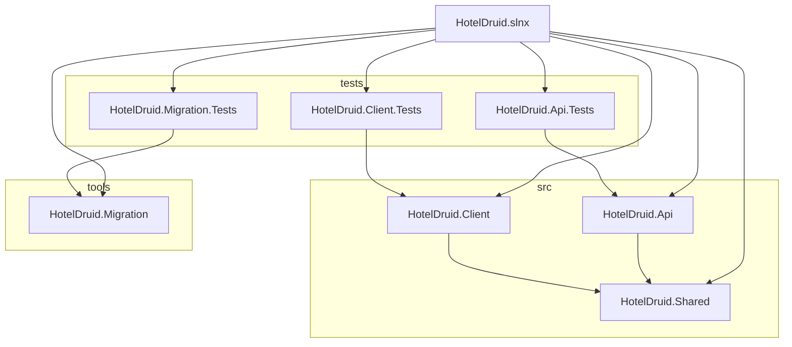

---

## 8. Call Hierarchy and Repository Groups

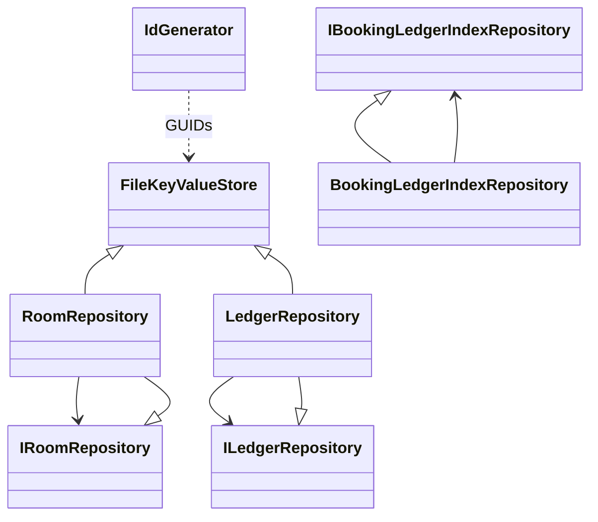

---

## 9. Entity/DTO Hierarchy

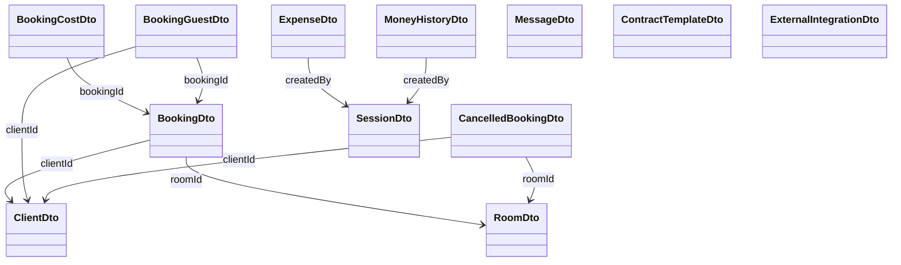

---

## 10. Booking Transaction Tracking

Payments, deposits, and refunds are journals in the global ledger. The booking finance list is a read-only projection of those journals. There is no second book under `bookings/{bookingId}_transactions/`.

A journal is two balanced lines that share a `journalId`. `BookingTransactionProjection` keeps lines whose source type is `booking-transaction`, collapses each journal to one event, and numbers those events 1..n by timestamp. `appliedTo` and `createdBy` are stored on the ledger line and returned on the projected row.

```
data/
  ledger/{year}/{month}/{day}/_seq_NNN.json   ← both sides of the journal
  bookings/{bookingId}/_ledger_index.json     ← debit line ids for this booking
```

When the index file exists, the list reads those entry ids. Otherwise it scans the booking date range with `GetEntriesForBookingAsync`. `GET` and `POST /api/bookings/{year}/{id}/transactions` still serve the finance page. POST writes only the ledger, then appends the debit line id to the index.

**Characteristics:**
- One ledger journal per payment, deposit, or refund
- The finance list shows one row per journal, numbered 1..n
- Applied-to and created-by round-trip through the ledger line
- The booking ledger index avoids scanning every day once it has been written

---

## 11. Repository Interface Design

### IAssetRepository<T> (Static Assets)

Used for: Rooms, RatePlans, Guests, Templates, Settings

```csharp
public interface IAssetRepository<T> where T : class
{
    // Lookup by human-readable name (via index)
    Task<T> GetByNameAsync(string name);

    // Lookup by GUID-base32 ID (direct file access)
    Task<T> GetByIdAsync(string id);

    // Create new asset (auto-generates GUID, updates index)
    Task<string> CreateAsync(string name, T data);

    // Update existing asset
    Task UpdateAsync(string id, T data);

    // List all assets
    Task<List<T>> ListAsync();

    // Rebuild index from data files
    Task RebuildIndexAsync();

    // Get raw index for introspection
    Task<Dictionary<string, string>> GetIndexAsync();
}
```

### ILedgerRepository (Transaction History)

```csharp
public interface ILedgerRepository
{
    // Get daily snapshot
    Task<LedgerSnapshot> GetSnapshotAsync(DateTime date);

    // Store daily snapshot
    Task SaveSnapshotAsync(DateTime date, LedgerSnapshot snapshot);

    // Append entry (auto-assigns sequence)
    Task<LedgerEntry> AppendEntryAsync(DateTime date, LedgerEntry entry);

    // Query incremental entries
    Task<List<LedgerEntry>> GetEntriesSinceSequenceAsync(DateTime date, int fromSequence);

    // Get all entries for a day
    Task<List<LedgerEntry>> GetEntriesForDateAsync(DateTime date);

    // Get all entries for a booking across date range
    Task<List<LedgerEntry>> GetEntriesForBookingAsync(
        string bookingId, DateTime from, DateTime to);

    // Consolidate snapshot + sequences into single view
    Task<List<LedgerEntry>> GetConsolidatedAsync(DateTime date);
}
```

### IBookingLedgerIndexRepository

```csharp
public interface IBookingLedgerIndexRepository
{
    // Null until the first read has recorded this booking
    Task<List<string>?> ReadIfPresentAsync(string bookingId);

    // First read stores every existing line id; later reads return that list
    Task<List<string>> GetOrBuildAsync(string bookingId, Func<Task<IReadOnlyList<string>>> build);

    // A new journal is added only after the index file exists
    Task AppendIfPresentAsync(string bookingId, IReadOnlyCollection<string> entryIds);
}
```

The per-booking transaction list is `BookingTransactionProjection`, not a repository. It groups the indexed ledger lines by journal and assigns the sequence the finance page sorts and selects on.

---

## 12. Implementation Phases

### Phase 1A: Core Storage Layer

**Deliverable**: Generic file-based KV store with concurrency

**Components:**
1. `FileKeyValueStore` class
   - `GetAsync<T>(collection, id)`
   - `CreateAsync<T>(collection, name, data)` → returns GUID
   - `UpdateAsync<T>(collection, id, data)`
   - `DeleteAsync(collection, id)`
   - `ListAsync<T>(collection)`
   - Atomic writes with SemaphoreSlim
   - Index management

2. `IdGenerator` utility
   - GUID → base32 conversion

3. Unit tests
   - Concurrent writes
   - Atomic crash safety
   - Index rebuild

**Non-deliverable yet:**
- Ledger (Phase 1B)
- Booking transactions (Phase 1B)

---

### Phase 1B: Storage Repositories

**Deliverable**: Room repository + basic ledger

**Components:**
1. `IRoomRepository` implementation
   - Uses `FileKeyValueStore`
   - Validation (no duplicate names, capacity bounds)
   - CRUD + listing

2. `ILedgerRepository` implementation
   - Daily snapshots
   - Incremental sequences
   - Consolidation logic

3. `IBookingLedgerIndexRepository` and `BookingTransactionProjection`
   - Entry ids per booking
   - One projected row per journal

4. Unit tests
   - Repository CRUD
   - Ledger consolidation
   - One row per booking-transaction journal

---

### Phase 2: API Endpoints

**Deliverable**: REST endpoints for rooms

**Endpoints:**
- `GET /api/rooms` — list all
- `GET /api/rooms/{id}` — get by ID
- `GET /api/rooms?name=Room-1` — get by name
- `POST /api/rooms` — create
- `PUT /api/rooms/{id}` — update
- `DELETE /api/rooms/{id}` — delete

**Features:**
- OpenAPI/Swagger documentation
- Proper HTTP status codes
- Error handling

---

### Phase 3: Blazor UI

**Deliverable**: Room list and management UI

**Pages/Components:**
- Room list view
- Room detail view
- Create/edit modal
- Delete confirmation

---

## 13. Key Design Decisions Reference

| Decision | Rationale | Implication |
|----------|-----------|------------|
| **In-memory mutex** | API is single process | Simple, no file locks |
| **GUID-base32 IDs** | Unique, URL-safe, compact | Self-documenting, no counter management |
| **Index files** | Name → ID mapping | Quick lookups, self-healing |
| **Explicit storage** | Historical accuracy | No defaults at read time |
| **Daily snapshots + sequences** | Performance + history | Avoid loading 10K+ files daily |
| **Immutable ledger** | Audit trail | Conflict resolution, compliance |
| **Booking transaction list** | One book | The list is a projection of ledger journals. Sequence, applied-to, and created-by come from those lines. |
| **Atomic writes** | Crash safety | No partial file corruption |


## 14. Current File Store Structure for Core Entities

This section reflects the currently implemented on-disk layout in the API.

### 14.1 Standard Collection Storage

All mutable entities are persisted under `dataRoot/collections/{collectionName}` with:
- one `_index.json` for human key to internal id lookup
- one `{id}.json` file per document (id is GUID-base32, 26 chars)

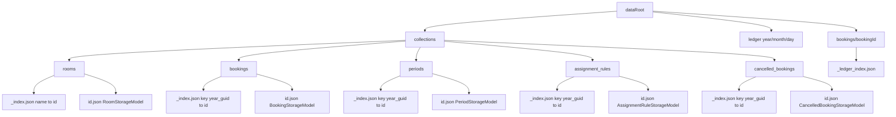

Key naming patterns used by year-scoped collections:
- `bookings`: index key is `{year}_{guidN}`
- `periods`: index key is `{year}_{guidN}`
- `assignment_rules`: index key is `{year}_{guidN}`
- `cancelled_bookings`: index key is `{year}_{guidN}`

### 14.2 Availability and Bookings: Technical Storage Model

There is no dedicated `availability` collection in the current implementation.
Availability is derived from persisted entities at query time.

Persisted inputs:
- `rooms` collection (room master data)
- `bookings` collection (confirmed/pending stays)
- `periods` collection (date/rate windows)
- `assignment_rules` collection (allocation constraints)

Derived output:
- availability result set returned by API logic/client workflow

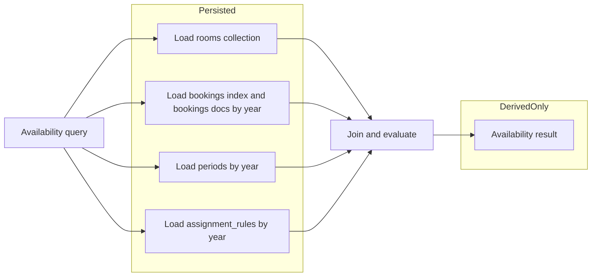

### 14.3 Atomic Persistence and Index Update Pattern

The base store writes every document atomically and keeps index files synchronized.

```csharp
var id = IdGenerator.GenerateId();
var filePath = GetDocumentPath(collectionName, id);

await AtomicWriteAsync(filePath, JsonSerializer.Serialize(document, _jsonOptions));

index[name] = id;
await SaveIndexAsync(collectionName, index);
```

---

## 15. API Caching Layers and Invalidation

The API currently uses three cache layers, each with different scope and invalidation semantics.

### 15.1 Cache Layers Summary

1. Endpoint query cache (Phase 3)
- Scope: API response-building queries (for example list bookings by year, list rooms)
- Keying: endpoint-specific cache key string
- Invalidation: tag-based (`InvalidateTag("rooms")`, `InvalidateTag("bookings")`)
- TTL: configurable (`EndpointQueryCacheTtlSeconds`)

2. Key-value in-memory cache (Phase 1)
- Scope: index and document objects per collection in process memory
- Invalidation: collection invalidation on create/update/delete/rebuild/delete-collection
- Bounds: collection count cap and expiration

3. Cross-instance version invalidation (Phase 2)
- Scope: coherence across multiple API processes using same data root
- Mechanism: shared version-stamp files under `.cache-invalidation`
- Effect: stale in-process entries are dropped on next read check

### 15.2 Request Path Through Cache Layers

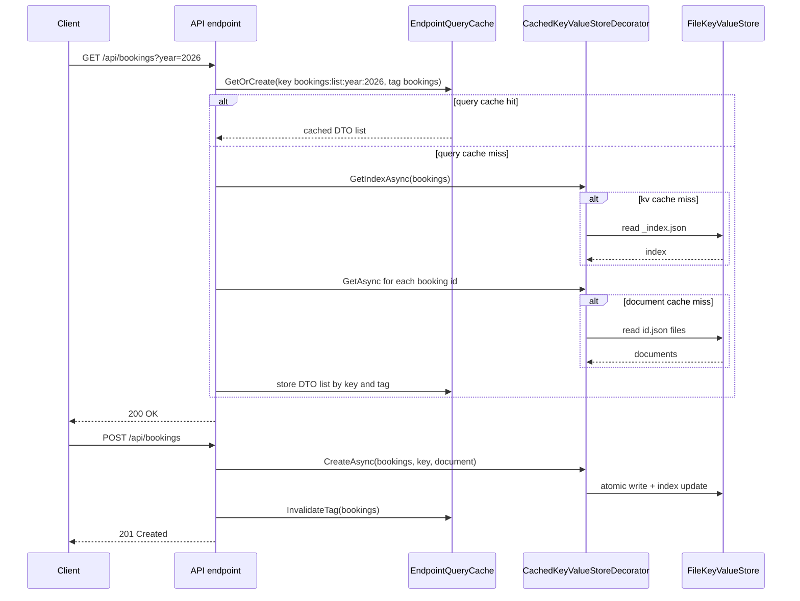

### 15.3 Cache Build-Up and Invalidation Lifecycle

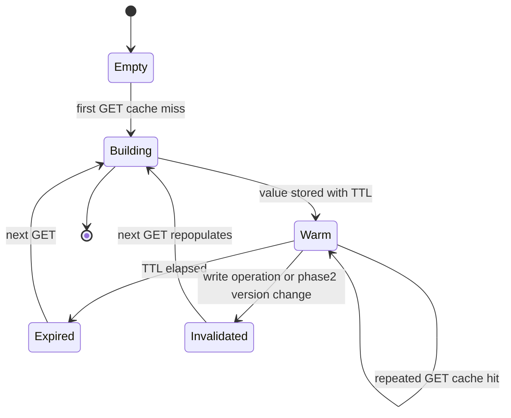

### 15.4 Minimal Invalidation Snippets

Phase 3 endpoint invalidation on write:

```csharp
var id = await store.CreateAsync("bookings", key, storage);
queryCache.InvalidateTag("bookings");
```

Phase 1 collection invalidation in key-value cache decorator:

```csharp
await _inner.UpdateAsync(collectionName, id, document);
InvalidateCollectionCache(collectionName);
```

Phase 2 cross-instance signal write:

```csharp
var stampPath = GetVersionStampPath(collectionName);
var stampValue = Guid.NewGuid().ToString("N");
await File.WriteAllTextAsync(stampPath, stampValue);
```

---

## 16. Document Template Render System

### 16.1 Overview

The render system converts stored HTML templates into guest-facing documents by assembling a `DocumentContext` from the store and substituting tokens in the template content. A single endpoint supports four output formats without any external dependencies.

**Endpoint:**
```
GET /api/documents/render/{type}/{number}?bookingId={id}&year={year}&format={format}
```

**Token syntax:**
- Scalar values: `{{Namespace.Field}}` — replaced with HTML-encoded data
- Repeating blocks: `<!-- FOREACH:ListName -->...{{Row.Field}}...<!-- ENDFOREACH:ListName -->`

**Default templates** are seeded by `DocumentTemplateSeeder` (an `IHostedService`) on first startup. Existing templates are never overwritten, making the seed restore-safe.

---

### 16.2 Supported Template Scenarios

| Template | Typical Use | Key Token Namespaces | FOREACH Lists |
|---|---|---|---|
| `booking-confirmation` | Printed or emailed booking confirmation sent at time of reservation | Hotel, Booking, Client, Room, Invoice | Guests, Costs |
| `invoice` | Billing document with full charge and payment breakdown | Hotel, Booking, Client, Room, Invoice | Costs, Payments, Guests |
| `receipt` | Simple payment receipt handed to guest after payment | Hotel, Booking, Client, Room, Invoice | Payments |
| `welcome-letter` | Formal arrival letter left in the room or handed at check-in | Hotel, Booking, Client, Room | Guests |
| `email-confirmation` | Email-safe HTML confirmation (inline CSS, no flex/grid) | Hotel, Booking, Client, Room, Invoice | Costs, Guests |

**Token namespace reference:**

| Namespace | Source | Example tokens |
|---|---|---|
| `Hotel` | `ISystemConfigurationStore` settings | `Hotel.Name`, `Hotel.Address`, `Hotel.City`, `Hotel.Phone`, `Hotel.Email`, `Hotel.VatNumber`, `Hotel.Currency` |
| `Booking` | `BookingStorageModel` | `Booking.Id`, `Booking.ArrivalDate`, `Booking.DepartureDate`, `Booking.Nights`, `Booking.Status`, `Booking.Notes` |
| `Client` | `ClientStorageModel` | `Client.FullName`, `Client.LastName`, `Client.FirstName`, `Client.Title`, `Client.Email`, `Client.Phone`, `Client.Street`, `Client.StreetNumber`, `Client.City`, `Client.PostalCode`, `Client.Nation`, `Client.TaxCode`, `Client.VatNumber` |
| `Room` | `RoomStorageModel` | `Room.Name`, `Room.Floor`, `Room.HouseNumber`, `Room.Capacity` |
| `Invoice` | Computed from costs | `Invoice.TotalAmount`, `Invoice.Currency` |
| `Document` | Runtime meta | `Document.Today`, `Document.TemplateType` |
| `Guest` (FOREACH) | `BookingGuestStorageModel` + `ClientStorageModel` | `Guest.GuestNumber`, `Guest.FullName`, `Guest.Email`, `Guest.Phone`, `Guest.Nationality`, `Guest.DateOfBirth` |
| `Cost` (FOREACH) | `BookingCostStorageModel` | `Cost.Description`, `Cost.Amount`, `Cost.TariffId` |
| `Payment` (FOREACH) | `MoneyHistoryStorageModel` | `Payment.Amount`, `Payment.Date`, `Payment.Method`, `Payment.Description`, `Payment.Type` |

**Output formats:**

| `format=` value | Content-Type | Behaviour |
|---|---|---|
| `html` (default) | `text/html` | Rendered HTML returned as-is |
| `print` | `text/html` | HTML with `window.print()` injected before `</body>` — triggers browser print dialog |
| `doc` | `application/msword` | Same HTML with Word content-type; Word/LibreOffice opens and re-renders |
| `eml` | `message/rfc822` | RFC 2822 multipart/alternative email; open directly in any email client |

---

### 16.3 Component Structure

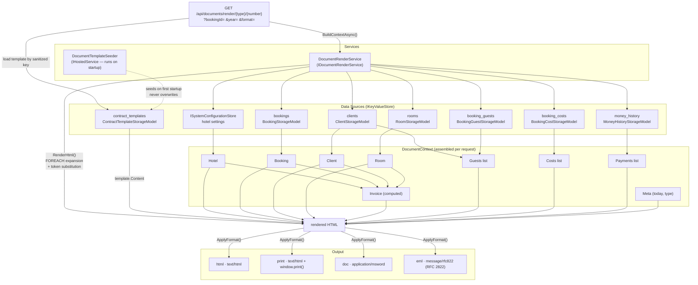

---

### 16.4 Render Request Sequence

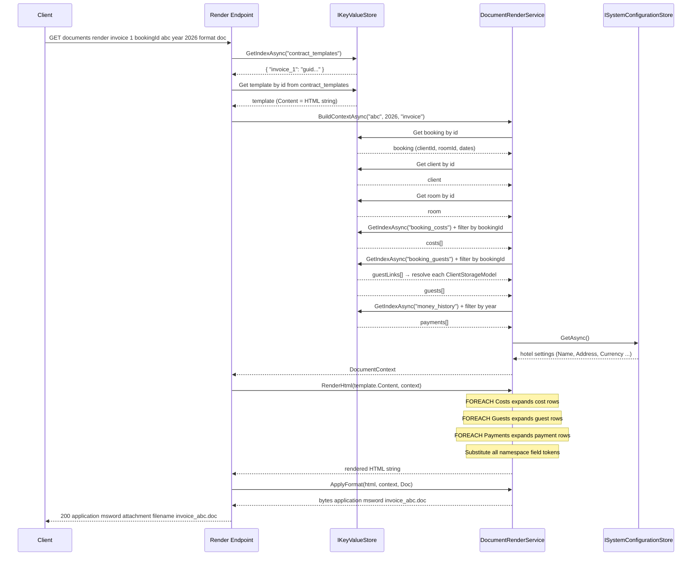

---

### 16.5 Seeder Behaviour

`DocumentTemplateSeeder` implements `IHostedService` and runs during application startup:

1. Loads the `contract_templates` index once.
2. For each of the five known template types, checks whether the index already contains the key (e.g., `invoice_1`).
3. If absent, reads the embedded resource (`HotelDruid.Api.Resources.Templates.{type}.html`) and calls `CreateAsync` to store it.
4. Logs a warning if an embedded resource is missing (graceful degradation — no crash).

The key sanitization matches the API endpoint: hyphens and other non-alphanumeric characters are replaced with `_`, so `booking-confirmation` → index key `booking_confirmation_1`.


## Container Deployment Profiles (Neutral)

For hosted, publicly accessible deployments, the architecture is intentionally
provider-neutral. The application does not hardcode a single reverse proxy,
certificate automation provider, or identity provider. Those are deployment
profile choices selected by administrators.

**Profile dimensions:**
- Reverse proxy mode: `nginx`, `caddy`, `traefik`, or platform ingress
- TLS mode: `self-signed` (internal only), `acme`, or externally managed certs
- Access mode: `private` (internal network) or `public`
- Auth mode: `keycloak-oidc`, another OIDC provider, or enterprise SSO gateway

**Security baseline:**
- Public profiles should require authentication and authorization.
- No public profile should be documented as anonymous by default.

**Recommended scenario set:**
- Internal validation: `self-signed + private + auth optional by policy`
- Public production: `acme + public + keycloak-oidc`
- Enterprise production: `external cert + public + keycloak-oidc`

**Why Keycloak is a strong option:**
- Centralized user, role, and realm management
- Standard OIDC/OAuth2 support for app and proxy integration
- SSO/MFA support for hardened public access
- Scales well in containerized deployments

### Scalable Container Topology

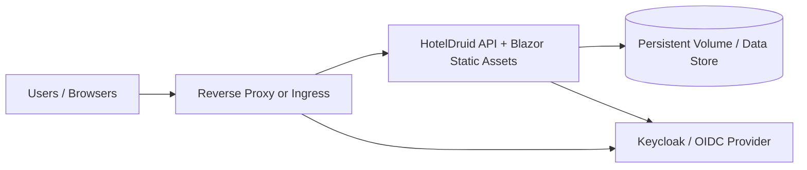

**Scalability notes:**
- Run multiple API replicas behind a reverse proxy/ingress.
- Keep identity and TLS termination outside application code.
- Persist data on durable volumes and plan for backup/restore workflows.
- Add health checks and readiness probes at proxy and API layers.

---

## 17. Getting Started

**Next Steps:**
1. Create `src/HotelDruid.Services/` project
2. Implement `FileKeyValueStore` with unit tests
3. Implement `IRoomRepository` with unit tests
4. Create `/api/rooms` endpoints
5. Wire Blazor UI to API

**Testing Strategy:**
- Unit tests for concurrency (multiple threads)
- Integration tests for file I/O
- HTTP client tests for API endpoints
- Manual testing with Postman

---

## 18. Initial Setup, Configuration, and Assumption Engine (Current)

This section documents the latest implemented behavior for first-run setup, system configuration persistence, and assumption-driven self-healing.

### 16.1 Configuration Persistence Model

- Configuration is persisted in the same file-backed object store pattern as other entities.
- Collection: `system_configuration`
- Logical singleton key: `system`
- Runtime store abstraction: `ISystemConfigurationStore`

Configuration API endpoints:
- `GET /api/system/configuration`
- `PUT /api/system/configuration`
- `DELETE /api/system/configuration`

Export/import integration:
- Export includes a canonical `system_configuration` table when configuration exists.
- Import can ingest `system_configuration` and persist it into the configured data store.

### 16.2 Setup State Detection and Admin Gating

Setup status endpoint:
- `GET /api/system/setup/status`

Returned setup signal is based on:
- local/admin mode detection
- missing configuration state
- explicit setup request (`?configure=true`)

Decision intent:
- enable guided setup for fresh deployments
- allow explicit re-entry into setup for reconfiguration

### 16.3 Setup UI Entry Point

- Blazor setup page: `/setup`
- Landing page checks setup status and redirects when setup is required.
- Setup page allows baseline configuration of defaults and assumption settings.

### 16.4 Assumption Rule Engine (Async Self-Healing)

Service:
- `IAssumptionRuleEngine` / `AssumptionRuleEngine`

Current triggers:
- missing year-scoped `periods` query result
- missing year-scoped `tariffs` query result

Current behavior:
1. Request for missing valid year returns empty list on first read.
2. API triggers asynchronous healing in background.
3. Engine clones source-year data into requested year.
4. Subsequent reads return generated data.

Source year resolution order:
1. explicit system configuration setting (`AvailabilityFallbackSourceYear` or `TariffFallbackSourceYear`)
2. configured default year
3. current UTC year
4. previous year fallback

Boundary condition:
- Assumption healing does not apply to invalid entity identifiers.
- Example: unknown room id remains `404 Not Found`.

### 16.5 Flow Overview

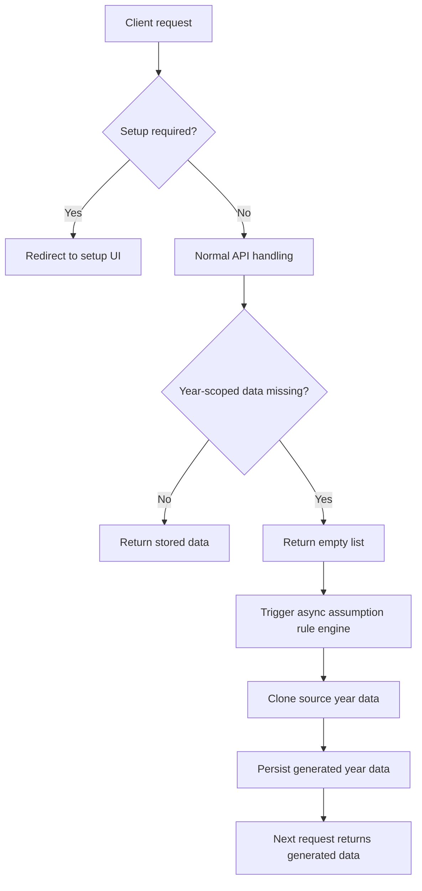

### 16.6 Test Coverage Snapshot

Implemented regression tests cover:
- configuration storage and CRUD endpoint behavior
- setup-state endpoint behavior for missing/explicit configuration modes
- configuration export/import inclusion and ingestion
- async self-healing for `periods` and `tariffs`
- non-healed invalid-entity paths returning `404`


## 19. Future Considerations

**Scalability Options** (when/if needed):
- Multi-instance deployment — would need distributed locking or message queue
- Cloud migration — ledger + snapshots make this natural

**Features** (Phases 2+):
- Export/import ZIP packages (canonical format)
- i18n (en, es, it)
- Advanced billing logic
- Integration APIs

---

## 20. Software Bill of Materials (SBOM)

For electronic processing, the industry-standard SBOM formats are:
- **SPDX** — broadly used for license and compliance exchange
- **CycloneDX** — broadly used for application security and dependency analysis

For this project, **CycloneDX JSON** is a practical format to embed in documentation because it is both machine-readable and easy to inspect in a fenced code block. The canonical SBOM should still be generated as a build artifact in CI/CD; the embedded example below is an architecture-level snapshot of the current solution structure and direct dependencies.

### 18.1 Embedded CycloneDX Example

```json
{
  "bomFormat": "CycloneDX",
  "specVersion": "1.6",
  "version": 1,
  "serialNumber": "urn:uuid:4d4d7d56-2d69-4d6f-bf70-eef0ea7d7d0b",
  "metadata": {
    "timestamp": "2026-05-23T00:00:00Z",
    "component": {
      "type": "application",
      "name": "HotelDruid",
      "version": "1.0.0",
      "description": "Blazor WebAssembly frontend with ASP.NET Core API backend for hotel management.",
      "components": [
        {
          "type": "framework",
          "name": ".NET",
          "version": "10.0.203",
          "purl": "pkg:generic/dotnet-sdk@10.0.203"
        },
        {
          "type": "container",
          "name": "mcr.microsoft.com/dotnet/sdk",
          "version": "10.0",
          "purl": "pkg:oci/dotnet/sdk@10.0?repository_url=mcr.microsoft.com"
        },
        {
          "type": "container",
          "name": "mcr.microsoft.com/dotnet/aspnet",
          "version": "10.0",
          "purl": "pkg:oci/dotnet/aspnet@10.0?repository_url=mcr.microsoft.com"
        }
      ]
    }
  },
  "components": [
    {
      "type": "application",
      "bom-ref": "pkg:generic/hoteldruid.api@1.0.0",
      "name": "HotelDruid.Api",
      "version": "1.0.0",
      "purl": "pkg:generic/hoteldruid.api@1.0.0",
      "properties": [
        {
          "name": "targetFramework",
          "value": "net10.0"
        }
      ]
    },
    {
      "type": "application",
      "bom-ref": "pkg:generic/hoteldruid.client@1.0.0",
      "name": "HotelDruid.Client",
      "version": "1.0.0",
      "purl": "pkg:generic/hoteldruid.client@1.0.0",
      "properties": [
        {
          "name": "targetFramework",
          "value": "net10.0"
        }
      ]
    },
    {
      "type": "library",
      "bom-ref": "pkg:generic/hoteldruid.shared@1.0.0",
      "name": "HotelDruid.Shared",
      "version": "1.0.0",
      "purl": "pkg:generic/hoteldruid.shared@1.0.0",
      "properties": [
        {
          "name": "targetFramework",
          "value": "net10.0"
        }
      ]
    },
    {
      "type": "library",
      "bom-ref": "pkg:nuget/Microsoft.AspNetCore.OpenApi@10.0.2",
      "name": "Microsoft.AspNetCore.OpenApi",
      "version": "10.0.2",
      "purl": "pkg:nuget/Microsoft.AspNetCore.OpenApi@10.0.2"
    },
    {
      "type": "library",
      "bom-ref": "pkg:nuget/Microsoft.AspNetCore.Components.WebAssembly@10.0.2",
      "name": "Microsoft.AspNetCore.Components.WebAssembly",
      "version": "10.0.2",
      "purl": "pkg:nuget/Microsoft.AspNetCore.Components.WebAssembly@10.0.2"
    },
    {
      "type": "library",
      "bom-ref": "pkg:nuget/Microsoft.AspNetCore.Components.WebAssembly.DevServer@10.0.2",
      "name": "Microsoft.AspNetCore.Components.WebAssembly.DevServer",
      "version": "10.0.2",
      "purl": "pkg:nuget/Microsoft.AspNetCore.Components.WebAssembly.DevServer@10.0.2"
    },
    {
      "type": "library",
      "bom-ref": "pkg:nuget/Microsoft.Extensions.Localization@10.0.0",
      "name": "Microsoft.Extensions.Localization",
      "version": "10.0.0",
      "purl": "pkg:nuget/Microsoft.Extensions.Localization@10.0.0"
    }
  ],
  "dependencies": [
    {
      "ref": "pkg:generic/hoteldruid.api@1.0.0",
      "dependsOn": [
        "pkg:generic/hoteldruid.shared@1.0.0",
        "pkg:nuget/Microsoft.AspNetCore.OpenApi@10.0.2"
      ]
    },
    {
      "ref": "pkg:generic/hoteldruid.client@1.0.0",
      "dependsOn": [
        "pkg:generic/hoteldruid.shared@1.0.0",
        "pkg:nuget/Microsoft.AspNetCore.Components.WebAssembly@10.0.2",
        "pkg:nuget/Microsoft.AspNetCore.Components.WebAssembly.DevServer@10.0.2",
        "pkg:nuget/Microsoft.Extensions.Localization@10.0.0"
      ]
    },
    {
      "ref": "pkg:generic/hoteldruid.shared@1.0.0",
      "dependsOn": []
    }
  ]
}
```

### 18.2 Architectural Guidance

- Keep the authoritative SBOM as a generated file published with build artifacts, not only as documentation text.
- Regenerate the SBOM whenever package references, target frameworks, base container images, or deployable components change.
- If license and compliance exchange becomes the primary requirement, emit an SPDX document in addition to CycloneDX.


---

## 21. Ledger parity and later work

The PHP-to-Blazor ledger checklist in [docs/ledger-parity-todo.md](docs/ledger-parity-todo.md) is complete. The booking reference is a dimension on the global ledger. Hotel cash leaves it empty. The finance list is a projection of those journals. Deposits credit the guest-deposits bucket until checkout applies them to the guest ledger.

The ledger posts six buckets: cash, guest ledger, guest deposits, room revenue, other income, and operating expense. Setup chooses the numbers. USALI is the default when nothing has been chosen (1000, 1200, 2400, 4100, 4900, 6100). The same buckets are also numbered from published charts: Switzerland, Kontenrahmen KMU (1000, 1100, 2030, 3400, 3600, 6700); Mexico, the SAT código agrupador (101.01, 105.01, 206.01, 401.01, 403.01, 601.84); Spain, the Plan General de Contabilidad (570, 430, 438, 705, 759, 629). Canada has no national account-number chart, and the Italian civil code does not assign numbers, so those hotels use USALI or Custom. Another standard is added by giving those same buckets its own numbers in `AccountChart.Standards`. Custom lets the hotel register the six numbers itself.

Saving setup writes a zero-amount journal, entry type `chart_of_accounts`, with one line on each new account number. The note names the chart and the six numbers in force from that entry forward, and, when a chart was already saved, the numbers the earlier journals keep. A later save of the same chart does not write another journal. The lines are omitted from booking totals. A money journal keeps the numbers it was written with. Changing the chart does not rewrite posted lines.

Base checks live with the API tests: balanced journals and filters in `LedgerApiTests`, stay and checkout and point-of-sale journals in `Layer4ApiTests`, the per-booking ledger index in `BookingLedgerHistoryTests`, and PHP money import in `PhpPackageImportTests`.

Two items were deliberately left for later:

- A per-room timeline that separates revenue earned per night, maintenance and renovation, and issue-driven downtime, so room profitability and utilization can be read over time.
- The hotel manual is `docs/manual`. `scripts/manual.ps1` refreshes its pictures from a running desk and writes the HTML guide and the epub.

Booking classification is a separate book: [docs/booking-lifecycle-consistency.md](docs/booking-lifecycle-consistency.md). List endpoints, check-in, check-out, and no-show are in place. What remains is import classification tests, a client test that clicks those actions, and the optional checkout audit fields `CheckedOutAt` and `CheckedOutByUserId`. `ActualDepartureDate` is already stored.

## 22. Identity front

Keycloak is a deployment choice, not a compile-time dependency. `IdentityFrontProbe` calls `GET /api/system/identity-front`.

The result is a front only when `Identity:Provider` is `keycloak` and the API receives an OpenID discovery document from `Identity:Issuer`. The browser address of the admin console is `Identity:AdminConsoleUrl` and is not used for the probe. Compose maps these from `IDENTITY_PROVIDER`, `IDENTITY_ISSUER`, and `IDENTITY_ADMIN_CONSOLE_URL`. See [docs/keycloak-setup.md](docs/keycloak-setup.md) and [docs/deployment-runbook.md](docs/deployment-runbook.md).

The realm to import is [deploy/keycloak/hoteldruid-realm.json](deploy/keycloak/hoteldruid-realm.json). It creates the realm `HotelDruid`, the client `HotelDruid-api`, the service client `HotelDruid-messages`, and five groups. Each group carries one realm role. The desk client's mapper writes a person's roles into the token claim `hoteldruid_roles`. The messages client is a service account with no browser sign-in. Every access token it issues carries `hoteldruid_roles` of `messages`, so an integration tool can call the batch inbox, the outbox, and the message cursor without a person signing in. Keycloak generates that client's secret at import. The hotel does not store it.

Sign-in is one directory, and that directory is Keycloak. The hotel does not create login users, does not assign groups, and does not call the Keycloak admin API. The Identity page only opens the Keycloak admin console in the browser. Who may use that console is a Keycloak administrator, which is not the hotel role `administrator`.

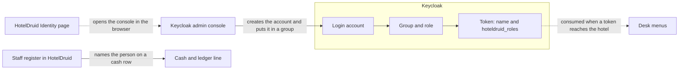

| What | Where it is kept | Who changes it |
| --- | --- | --- |
| Who may sign in | Keycloak account | A Keycloak administrator, in the Keycloak console |
| `administrator`, `clerk`, `room-service`, `reports` | Keycloak group and realm role, then the claim `hoteldruid_roles` | The same console. The hotel only reads the claim |
| `messages` | Service client `HotelDruid-messages`. The token claim is fixed to that role | The same console, as a client secret. Not a desk login |
| Name on a cash or ledger line | HotelDruid staff register: Users, groups, privileges | The hotel pages, from the imported PHP register |
| What the desk shows | Not stored. Derived from `hoteldruid_roles` once a token arrives | Nobody edits this list inside the hotel |

The staff register is the old list of people who worked the desk. It is not a second copy of Keycloak. A cash row still needs a name when no token is present, which is why those pages exist. They do not grant sign-in, and Keycloak does not read them.

| Group and role | What that person may do |
| --- | --- |
| `administrator` | The whole hotel, including setup |
| `clerk` | Reservations, guests, arrivals, stays, the cashier, and reports |
| `room-service` | Room status, who is staying, and who is leaving |
| `reports` | Reports only |
| `messages` | The batch inbox, the outbox, and the message cursor. Not a person at the desk |

A person is placed in a group, or given the role directly. More than one role keeps every matching area. The hotel does not narrow the desk from this claim until a signed-in token reaches it. Until then the desk stays open.

When `isFront` is true, the drawer shows Identity plus the staff-register pages (Users, User Groups, and User Management). Those pages edit the register. They do not write to Keycloak. The probe does not sign a desk user in. Requiring a token stays with the reverse proxy.

When Keycloak is absent, or the probe fails, that whole segment stays out of the drawer. The desk is open: every other menu remains. An operator can still open `/identity` and see that no front is deployed.

The API data directory is `HOTELDRUID_DATAROOT`. The container image and compose file set that name. The older `HotelDruid_DATAROOT` spelling is not read on Linux.

The browser cannot read the operating-system account, and it cannot read a Keycloak session that lives on another origin. When a request arrives already authenticated, the API records `preferred_username`, then `name`, then `sub`. When it is not, the desk name stored in this browser under `hoteldruid.deskUser` is sent as `X-HotelDruid-Desk-User` and written on ledger lines that do not already name a person. The person sets that name on Profile. Each private browser keeps its own name, so several people can share one desktop. The footer links to that page and shows the name in force. A signed-in token replaces it. An unnamed caller is left blank. The fallback word admin is not written on a journal.

## 23. Navigation

The drawer in `Layout/NavMenu.razor` is the menu. Rooms and Calendar are on it because the dashboard already works through those pages.

These groups stay because the ledger and the desk still use them:

- Rooms, calendar, bookings, booking costs, booking guests, cancelled bookings, tariffs, periods, years, assignment rules, extra costs.
- Clients and client data, and the reference lists (nations, regions, cities, document types, family relationships).
- Assets, warehouses, inventory, point of sale, cash registers.
- Expenses, money history, general ledger, chart of accounts. Money history is the cash journal. The ledger is the book. They are not two copies of the same screen.
- Messages, contract templates, external integrations, settings, and setup.

Users, user groups, privileges, group memberships, and user preferences are the imported staff register. A cash row still names a person from that register. They are not the login directory. Section 22 shows them in the drawer only while Keycloak is the front. Sessions stays under Communication.

`Shared/NavMenu.razor` was an unused English-only menu and has been removed. `/home` was the unused Blazor template page and has been removed. The desk home is `/`.

Resource keys used by the screens exist in English, Italian, and Spanish. A number of one-off buttons on the older maintenance pages are still literal English (`Add User`, `Change Password`, `Settle & Close Folio`, `Remove from Archive`, `Mark Read`, and similar). Load and Edit on those pages use the shared resource keys.

## 24. Backup and logs

The desk backup is a scheduled call to `POST /api/export/create`, then a download of that zip. The task is `HotelDruid Backup`. It runs as the Windows user who configured it, and only while that user is signed in, so the destination can be a OneDrive folder or a network share. The service account writes the working zip under `C:\ProgramData\HotelDruid\exports` and does not need rights to the destination. How to set the folder, the time, and the retention, and which log files to prune, is the Deploy chapter of [docs/manual](docs/manual/chapters/01-deploy.md).

Application logs are one file per calendar day, `api-yyyyMMdd.log`, in the directory named by `HOTELDRUID_LOGDIR`. The process console before that logger starts is `api-startup.log`. Each export attempt appends one line to `backup.log`.

## References

- [Architecture Decision Log](ARCHITECTURE.md) (this file)
- Implementation code in `src/HotelDruid.Api/`

