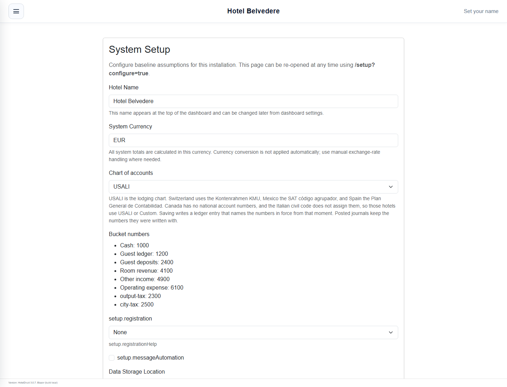
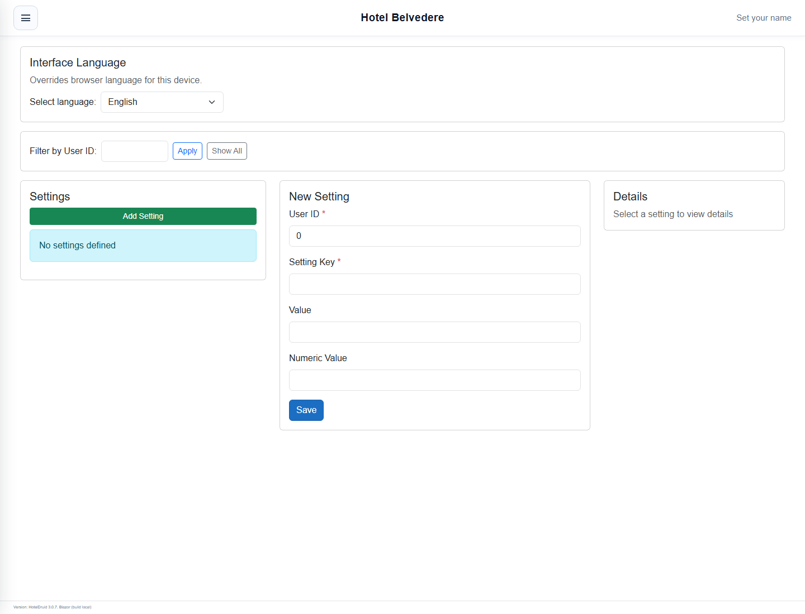

# House settings

Do this once, before the first real guest. Open **Setup**.

| Setting | Where | If it is left wrong |
| --- | --- | --- |
| Hotel name | Setup | Letters and the desk title use another name. |
| Currency | Setup | Every amount is in the wrong currency. |
| Timezone | Setup | The business day and the times on screen follow another clock. Blank uses the computer that runs the hotel. |
| Chart of accounts | Setup | Ledger numbers will not match the accountant. Do not change the chart after money has been posted. |
| Guest registration | Setup | [Night audit](10-night.md) checks the fields that standard requires. The printed card is the letter in [Letters](15-letters.md). Spain marks the Spanish registration letter for check-in. The wording stays editable. Any letter can be marked the same way. |
| Inbox automation | Setup | On: a structured message can become a booking. Off: it waits on [Received](06-reservations.md). |
| Tariffs and assignment rules | [Rates](12-rates.md) | A room with no rule has no price. An arrival then has no tariff. |
| Tax rates | [Accounts](13-accounts.md) | Inclusive prices already contain the tax. The bill shows the recap and does not add the tax again. |
| Letters | [Letters](15-letters.md) | The desk language does not change the letter. The wording in the file is what prints. |
| Clerk name | [People](16-people.md) | Ledger lines have no name. |
| Backup folder | [Deploy](01-deploy.md) | There is no nightly copy. |
| Cash register | [Cash](11-cash.md) | Takings are not tied to a drawer. |

The data folder shown on Setup is read-only here. `HOTELDRUID_DATAROOT` chooses it before the program starts.

The screen language is **Settings**, not Setup. It changes menus. It does not choose the invoice.

Next: [The desk](04-desk.md).
