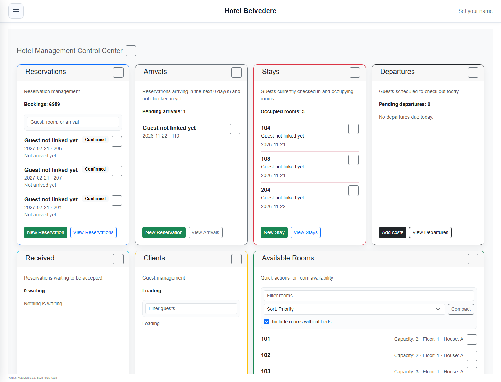

# The desk

Home is the day's work. Set the clerk name first. See [People](16-people.md).

| Box | Use it for |
| --- | --- |
| Reservations | Stays not yet arrived. Open one, or start a [reservation](06-reservations.md). |
| Arrivals | Due and not checked in. **Arrived** opens [Arrivals](07-arrivals.md). It does not check the guest in. |
| Stays | In house. Purchases and room changes are [In house](08-inhouse.md). |
| Departures | Due to leave. [Check-out](09-checkout.md). |
| Received | Partner and channel bookings waiting to be accepted. |

The menu on the left is the same work, grouped. Each page in this manual is one of those entries.

Next: [Guests](05-guests.md).
