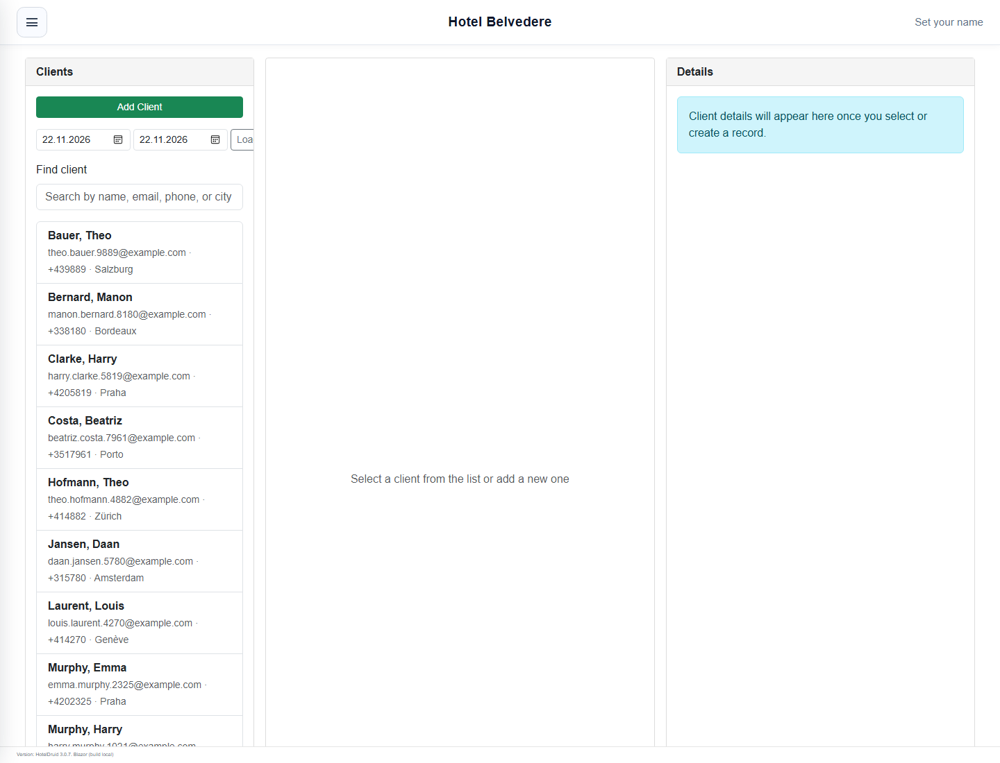
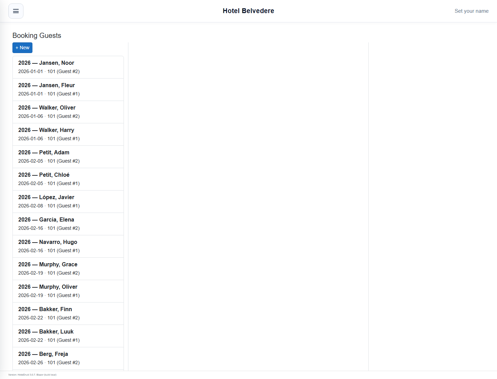
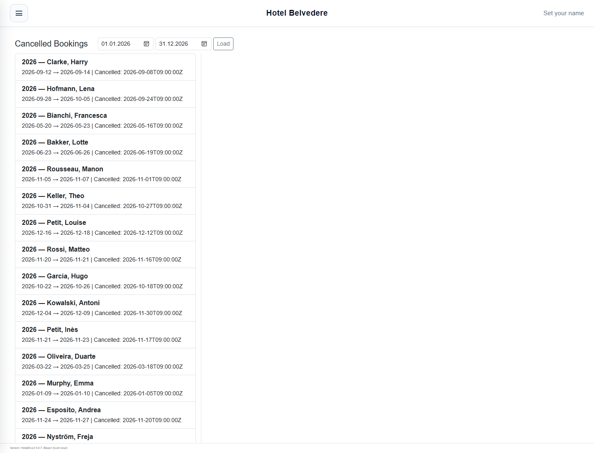

# Guests

A stay needs a surname. The other fields are what the registration standard and the invoice ask for.

## Clients

1. **Clients** → new, or search and open.
2. Record the name, the address, and the document fields the [house standard](03-house.md) requires.
3. Save.

The guest record is the person. It is not the stay. The same person can return.

## Other people in the room

1. **Booking Guests**.
2. Attach each other occupant to the booking.
3. A card is printed per person on [arrival](07-arrivals.md). Night audit counts the names the standard requires.

## Cancelled

**Cancelled Bookings** is the list of stays that were cancelled. Open one to read it. It is not a new reservation.

Next: [Reservations](06-reservations.md).
