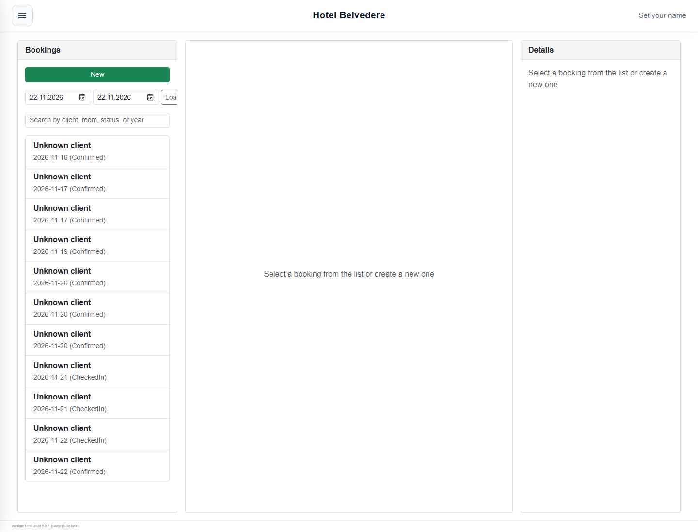
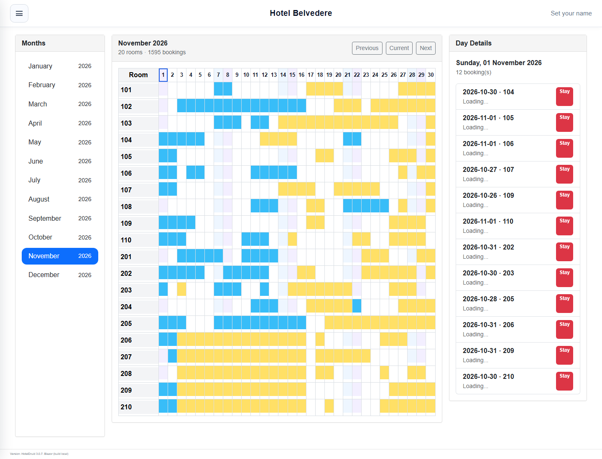
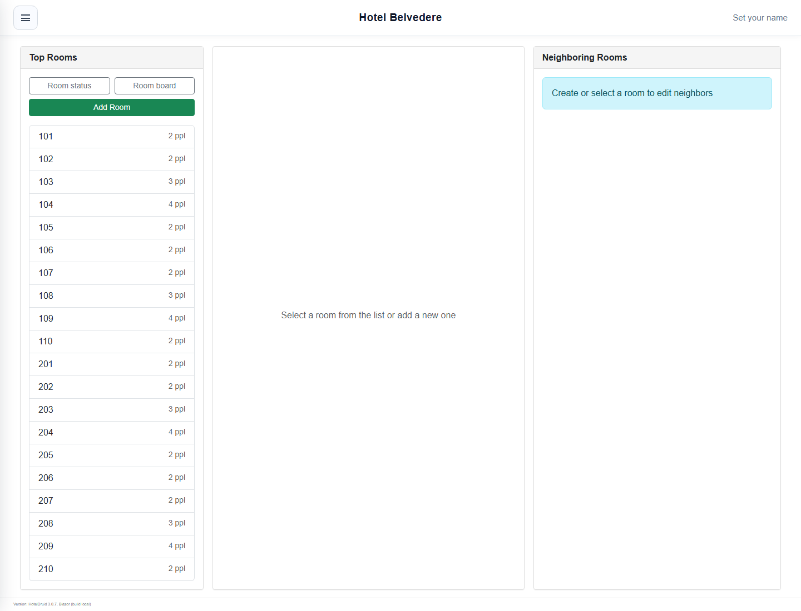
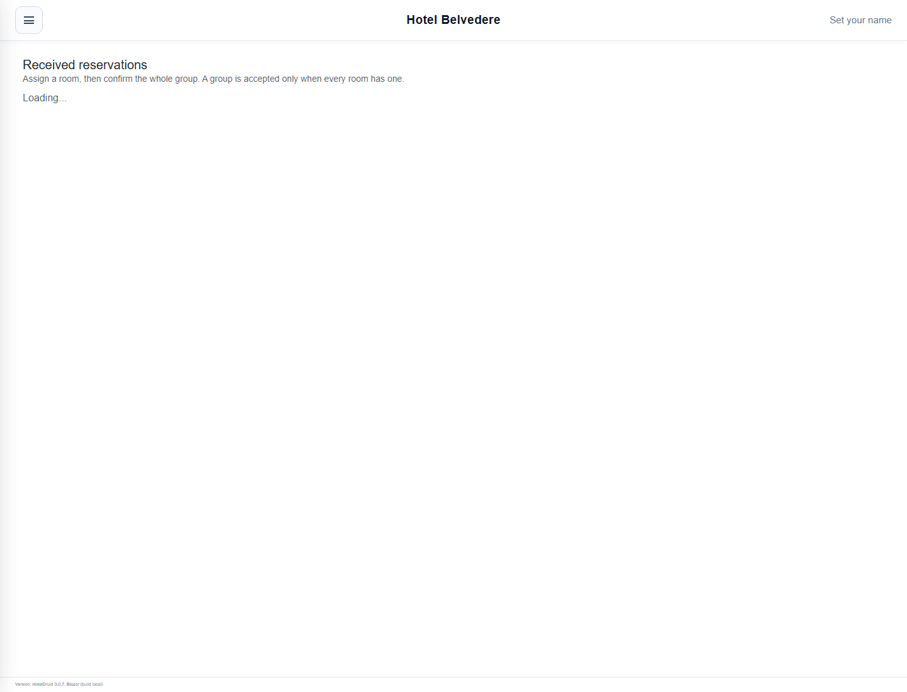
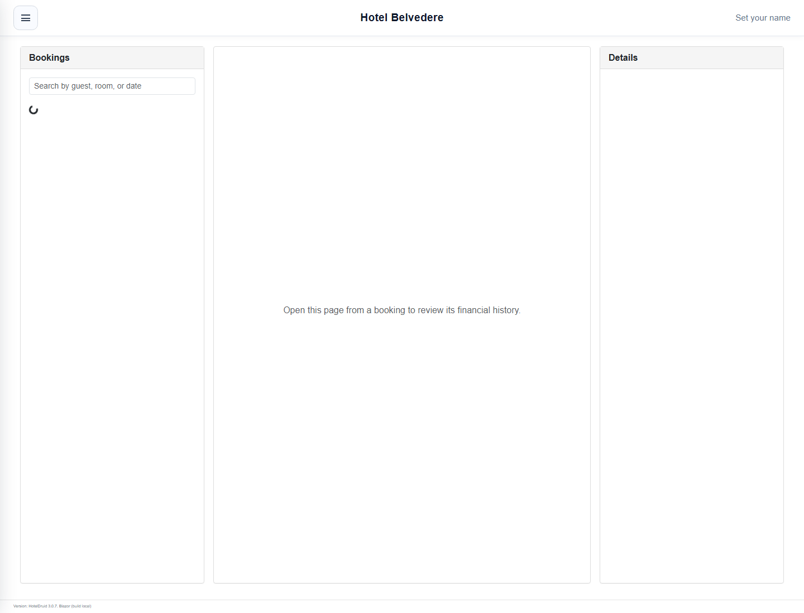

# Reservations

## New stay

1. **Bookings** → **New**.
2. Fill the room, the arrival, the departure, the number of persons, and the guest surname.
3. Save.

The price comes from the tariff for that room, those dates, and that number of people. See [Rates](12-rates.md). If no tariff applies, do not leave the stay without a price. An arrival with no tariff is a failed reservation.

The right-hand panel is the stay. Payments under the guest are a list: what was paid, and the date. The heading opens the money page.

## Calendar

**Calendar** shows who is in which room. Use it to pick a free room before you save.

## Rooms

**Rooms** is the house: name, beds, floor. A room that is missing here cannot be sold.

## Received

**Received** holds bookings that arrived from a channel or a message and are not accepted yet. Accept the ones the house will honour. With inbox automation off, this is where those messages wait. See [House settings](03-house.md).

## Money on the stay

Open the stay, then the amount, or **Payments**.

Record a deposit or a payment with the amount, what it applies to, and who recorded it. A deposit is held until [check-out](09-checkout.md). It is not the same as a payment against the stay. The bill's amount due already subtracts a deposit still held.

Taking money at the door, with a payment code, is [Arrivals](07-arrivals.md).

Next: [Arrivals](07-arrivals.md).
