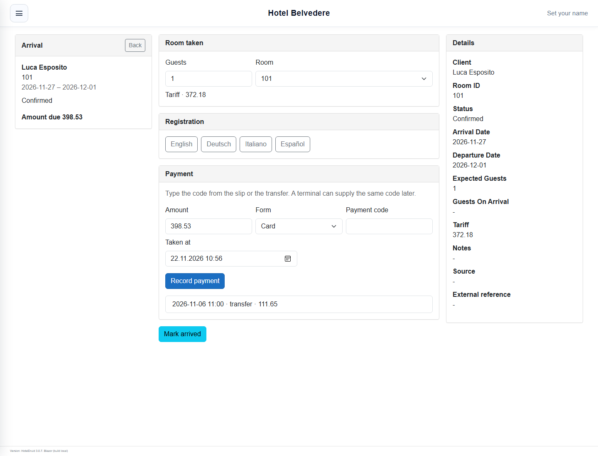

# Arrivals

**Arrived** on the desk, or on the booking, opens this page. The guest is not in house until **Mark arrived**.

Left: this stay only. **Back** returns to the previous page. Middle: the work. Right: the same stay detail as the booking.

## Registration card

1. Open the letter for the language the house uses. The buttons are the copies under [Letters](15-letters.md).
2. The card is already filled with the guest and the stay.
3. Print it. The guest signs it. File the paper.
4. Do not scan the identity document into the hotel. Check the card against the document, then type any missing field on the [guest](05-guests.md).

Which fields are required is the registration standard in [House settings](03-house.md). [Night audit](10-night.md) lists the gaps.

## Payment

1. The amount starts as what is still due after any deposit.
2. Choose cash, card, or transfer.
3. Card and transfer need the code from the slip or the transfer. Type it. A terminal, when one is connected later, supplies the same code.
4. Set the time if it is not now.
5. **Record payment**. The code is stored on the ledger line so it can be matched to a terminal log.

Cash does not need a code. A card payment is not cash in the drawer.

## Room actually taken

1. Change the number of guests or the room when the party is not the one that was booked.
2. The tariff for that room and that number must exist. See [Rates](12-rates.md).
3. If you leave the room as booked, the price already on the stay is kept.
4. **Mark arrived**.

A guest already in house can still print a card and record a payment here. The room change for someone already in house is [In house](08-inhouse.md).

Next: [In house](08-inhouse.md).
