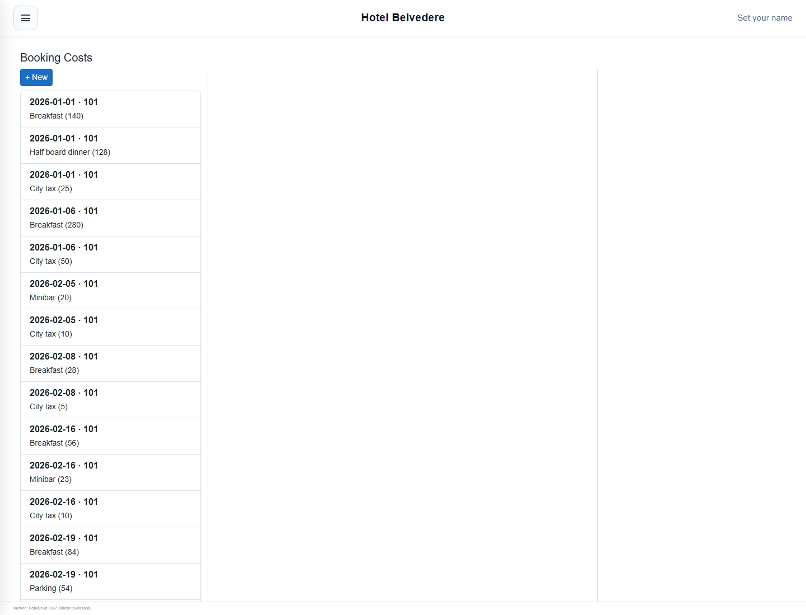
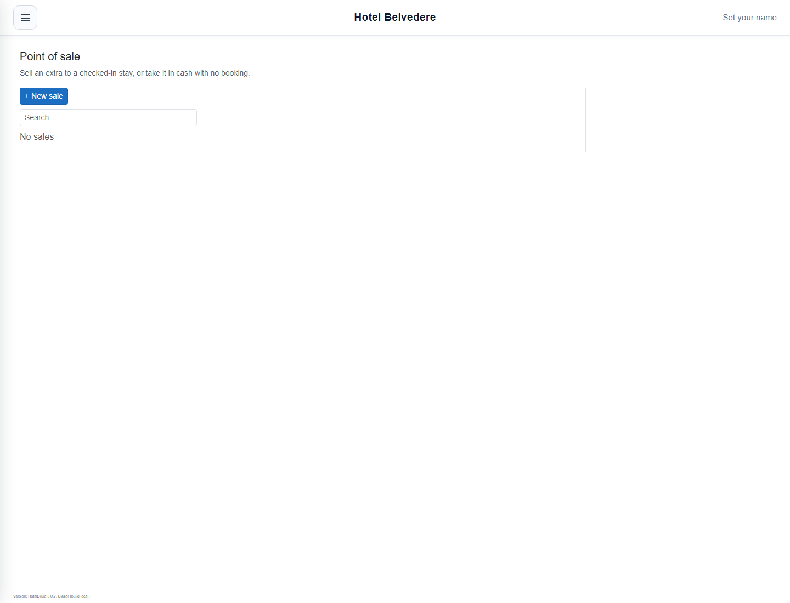

# In house

These are stays in the Stays box on [the desk](04-desk.md).

## Change the room

On the booking, move the guest from the date they change room. The tariff follows the room they take. A move is not a new reservation.

## Extras on the stay

**Booking Costs** posts an extra on one stay, such as a cot or a late dinner charged to the room.

The kinds of extra, and the dates they apply, are [Rates](12-rates.md).

## Counter sales

1. **Point of Sale**.
2. Choose the in-house stay, or a walk-up guest.
3. Sell. Cash or card.
4. A sale on a stay is charged to that guest and appears on the bill at [check-out](09-checkout.md).

Name the drawer when you take money. See [Cash](11-cash.md).

Next: [Check-out](09-checkout.md).
