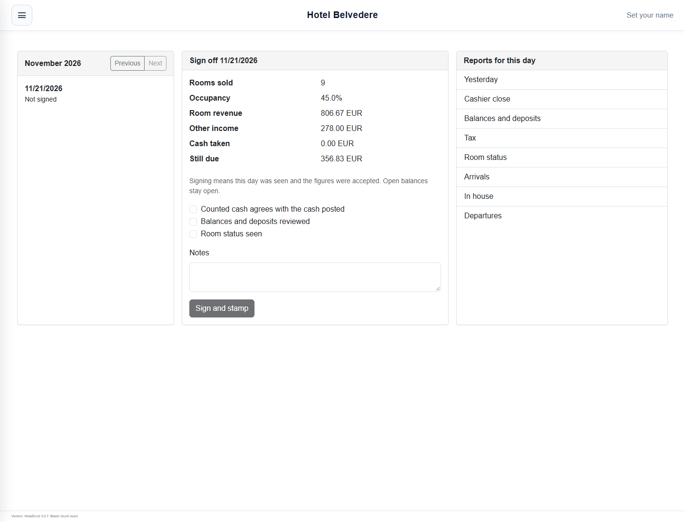

# Night audit

Open **Night audit** after the departures are done.

The page lists what the day still misses: a registration field the [standard](03-house.md) requires, an open departure, a stay with no tariff.

Read the list. Fix the rows you can. Stamp the day when the list is accepted.

The stamp means the day was seen. It does not mean the guest paid. Do not stamp a day the house is still selling.

Next: [Cash](11-cash.md).
