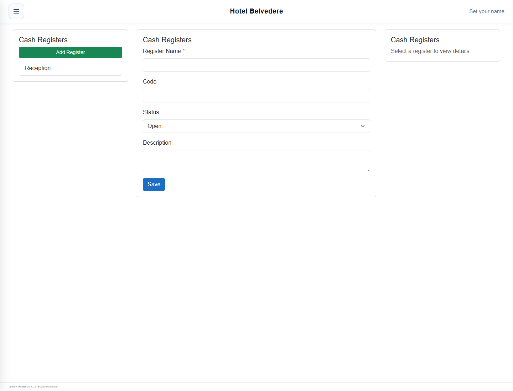
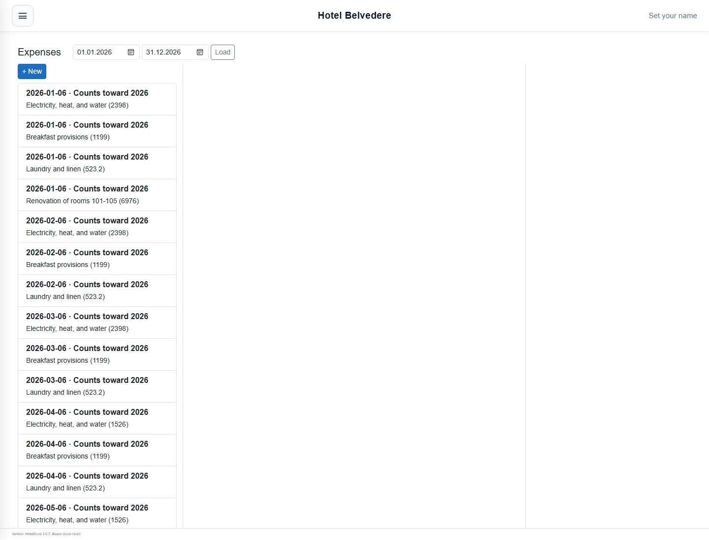
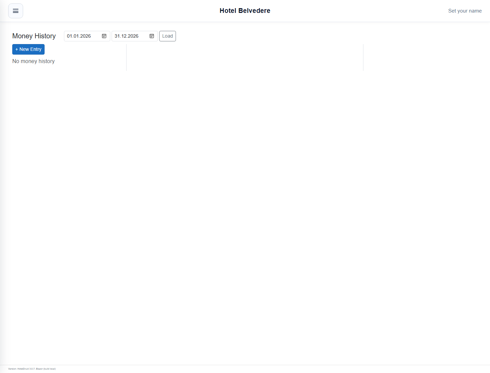

# Cash

## Drawers

**Cash Registers** is each drawer or terminal the desk uses. Open the one that is taking money before the shift. A payment recorded against a stay should name that drawer when the house keeps more than one.

## Paid out

**Expenses** is money leaving the house: a supplier, a petty-cash purchase. Record the amount, what it was, and whether it counts toward the day.

## What moved

**Money History** is the list of payments, sales, and paid-outs. Use it to match a payment code from [Arrivals](07-arrivals.md) to a terminal slip.

A card payment is not cash counted in the drawer. The code on the ledger line is how the two are reconciled.

Next: [Rates](12-rates.md).
