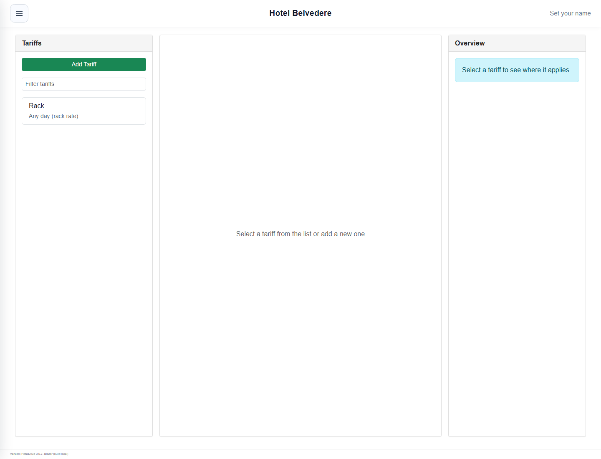
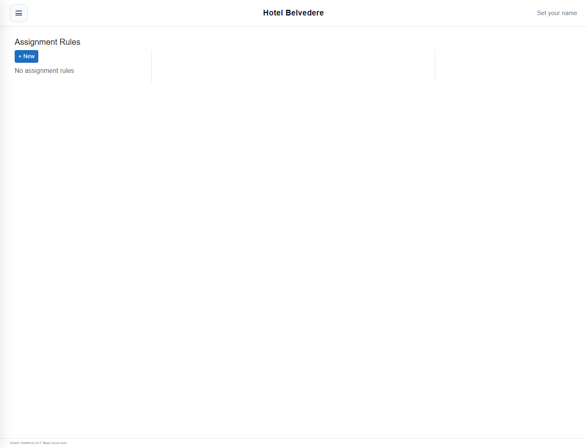
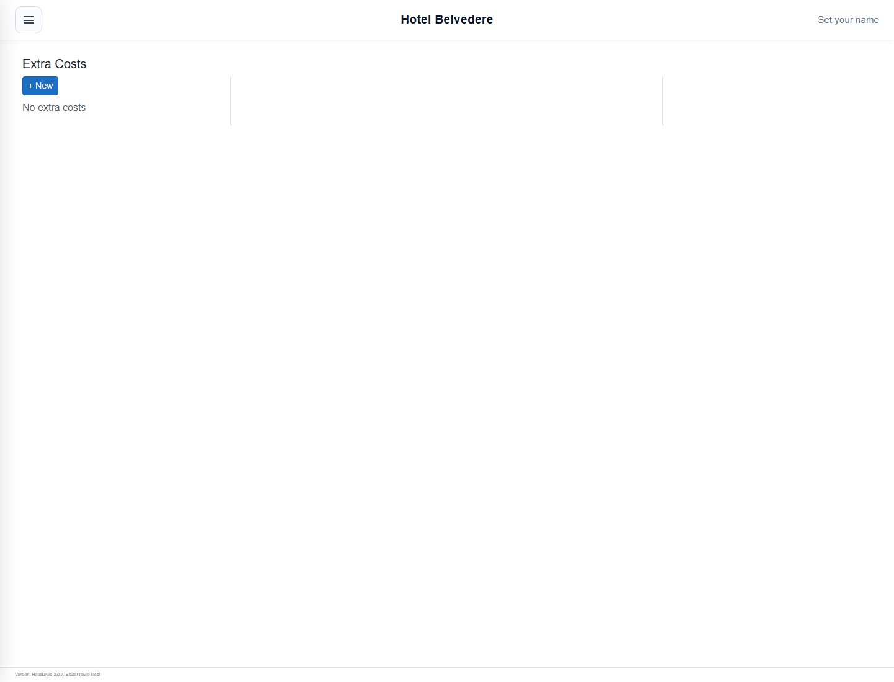

# Rates

A price is a tariff plus the dates it applies, for a room and a number of guests.

## Tariffs

1. **Tariffs** → add the plans the house sells.
2. Set the price and the dates.

## Which room gets which plan

**Assignment Rules** binds a tariff to rooms. A room with no rule cannot be quoted. [Reservations](06-reservations.md) and [Arrivals](07-arrivals.md) then have no price for that room.

## Extras

**Extra Costs** is a charge that is not the room: breakfast, a cot, parking, and the dates it can be sold. Posting one onto a stay is [In house](08-inhouse.md).

Next: [Accounts](13-accounts.md).
