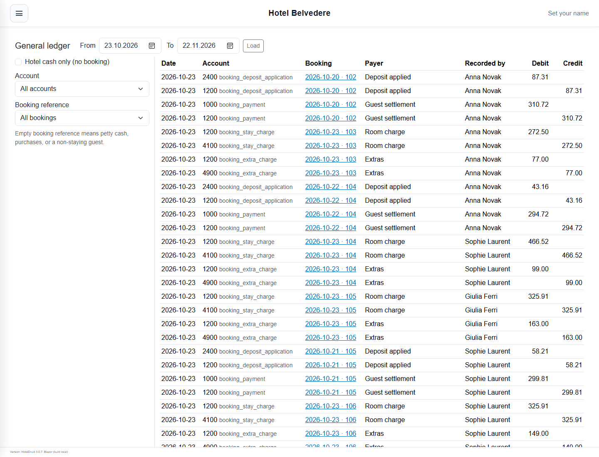
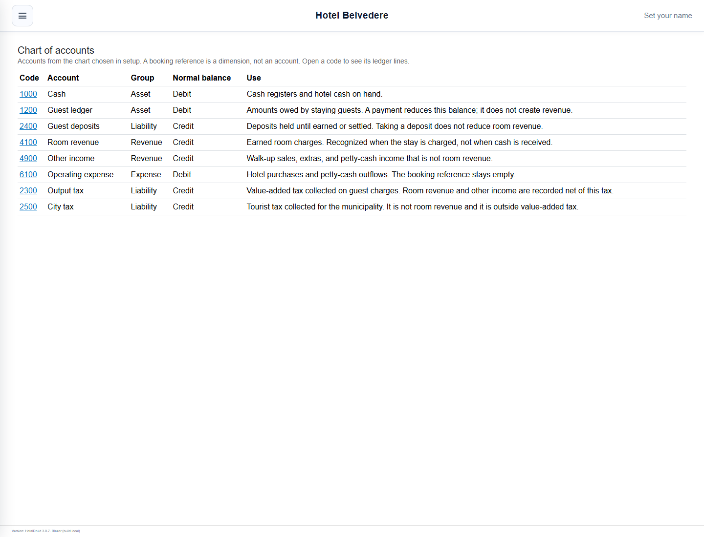
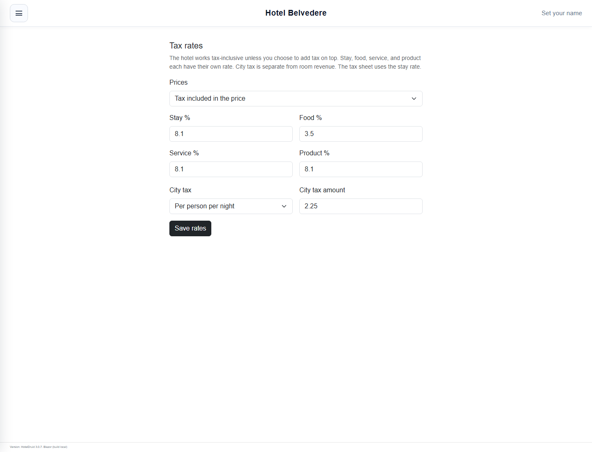
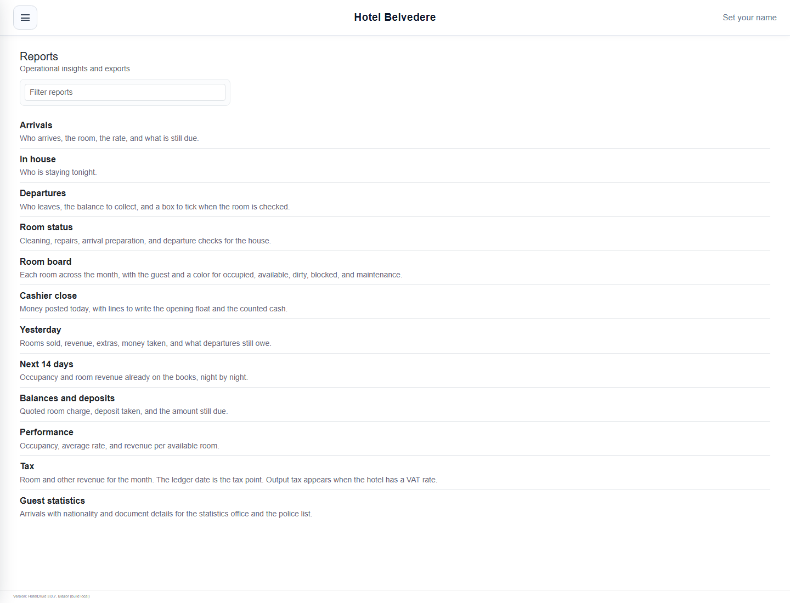

# Accounts

The numbers are the chart chosen in [House settings](03-house.md).

## Ledger

**General Ledger** is every posted line. Guest charges, payments, deposits, tax, and expenses land here. A payment code from the desk is on the payment line.

Do not edit history to correct a price. Post the adjustment.

## Chart

**Chart of Accounts** shows the numbers in use. Changing a number after postings exist splits the history across two codes.

## Tax

**Tax rates** holds the percentages. When the house price is inclusive, the tax is inside the price. The invoice shows a recap. It does not add the tax a second time.

## Reports

**Reports** is the printed lists: arrivals, in house, departures, and the cashier close. Open the one the shift needs.

Next: [Property](14-property.md).
