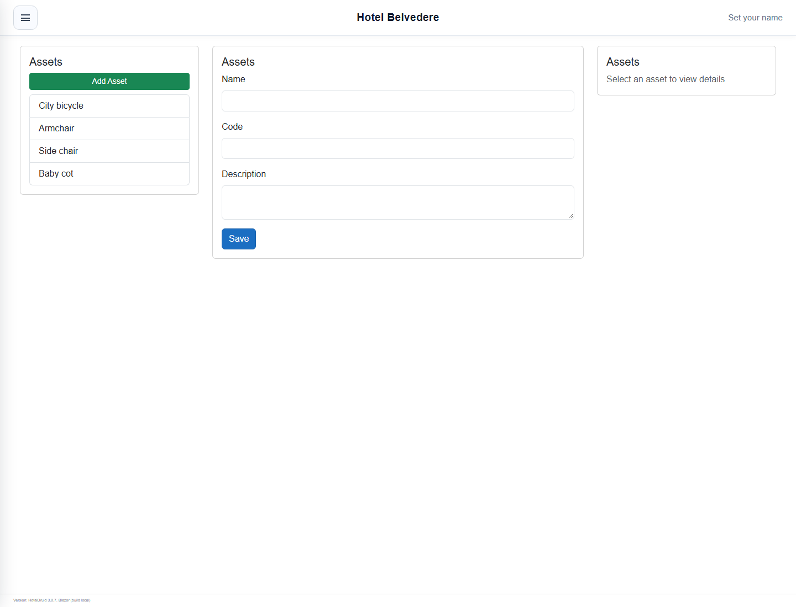
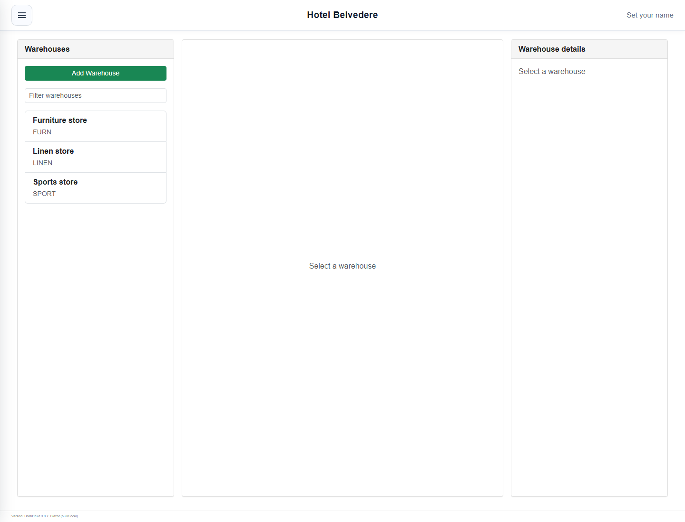
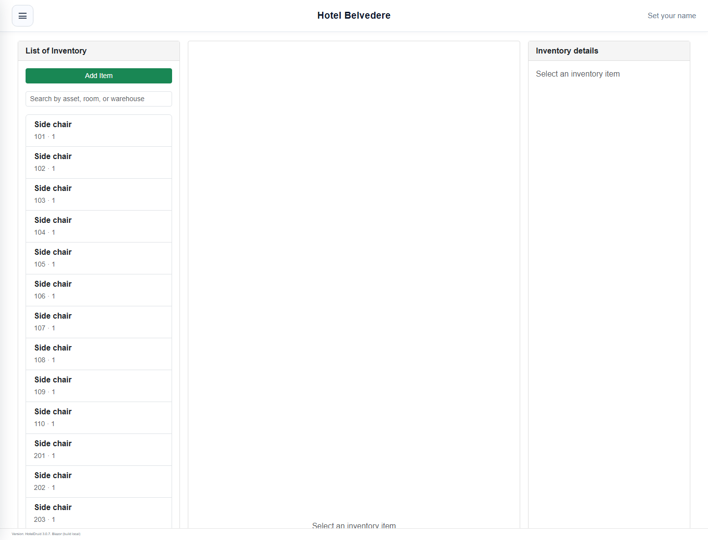

# Property

Rooms that can be sold are under [Reservations](06-reservations.md). This chapter is the rest of the building.

## Assets

**Assets** is equipment the house tracks: a boiler, a vehicle, a large fitting.

## Stores

**Warehouses** is where stock sits. **Inventory** is the items and the quantity.

Next: [Letters](15-letters.md).
