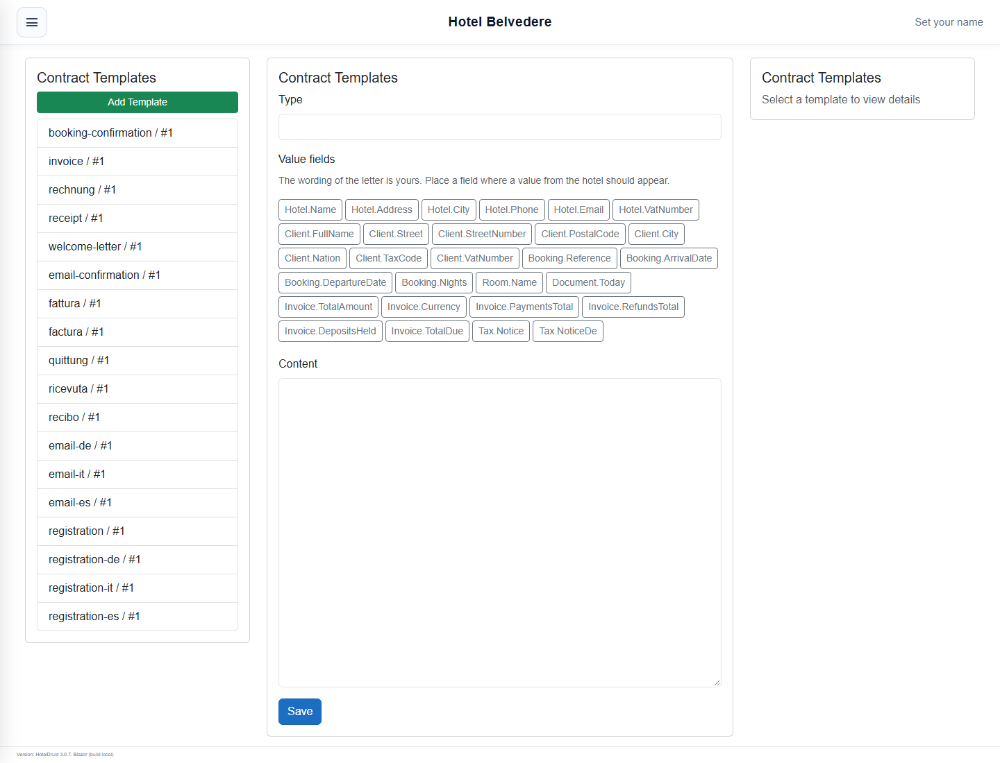
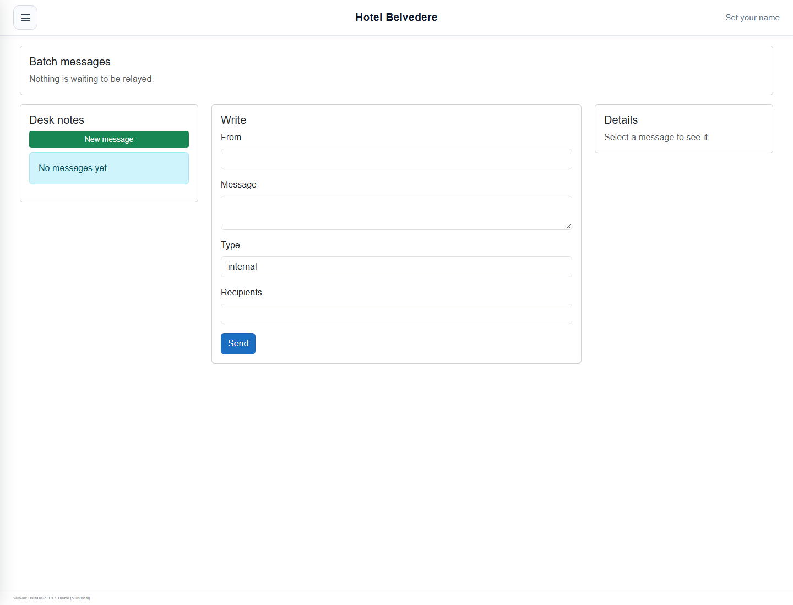

# Letters

**Contract Templates** holds the invoice, the receipt, the confirmation email, and the registration card. There is one copy for each language the house prints.

1. Open the letter.
2. Leave the sentences as the house wants them. The program does not translate the headings.
3. Place a value field where a figure or a name should appear: the guest, the dates, the room, the amount due.
4. Save.

The desk language in [House settings](03-house.md) does not choose which letter prints. The button the clerk presses does. Print the copy written in the hotel's language.

A registration card is filled the same way and opened from [Arrivals](07-arrivals.md). An invoice number is given to the invoice copies. A receipt does not take that number.

**Messages** is the inbox for those confirmations and for channel mail. Send from the stay when the guest should receive the letter. Do not use a live guest address while training on the [demo](02-demo.md).

Next: [People](16-people.md).
