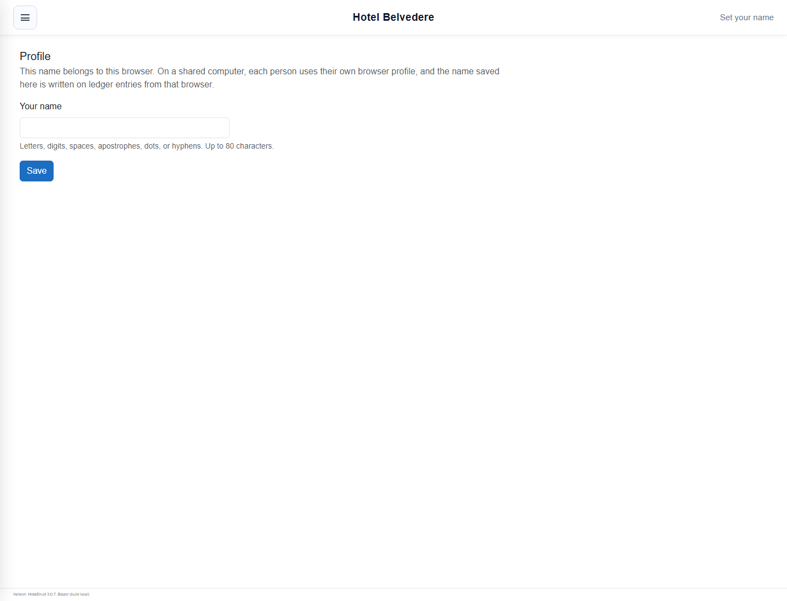

# People

## Clerk name

On Home, **Set your name**, or open **Profile**. That name is written on ledger lines. Each browser can keep its own name, which is enough when several people share one desk without signing in.

## Screen language

**Settings** changes the menus for this browser. English, Spanish, or Italian. It does not change [letters](15-letters.md) and it does not change another person's browser.

## When sign-in is on

**Users**, **User Groups**, and privileges exist when the hotel uses an identity provider. A desk with no sign-in hides that work and uses the profile name instead.

Roles and the public sign-in server are [Keycloak](../../keycloak-setup.md). Putting the desk on a public address is the [deployment runbook](../../deployment-runbook.md).

Back to [Deploy](01-deploy.md).
