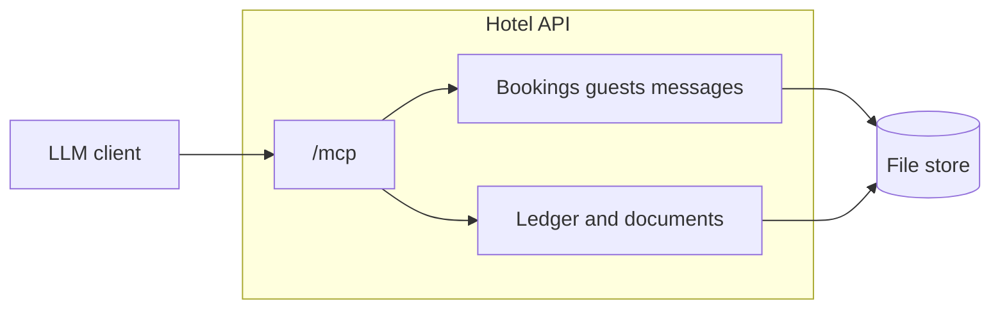
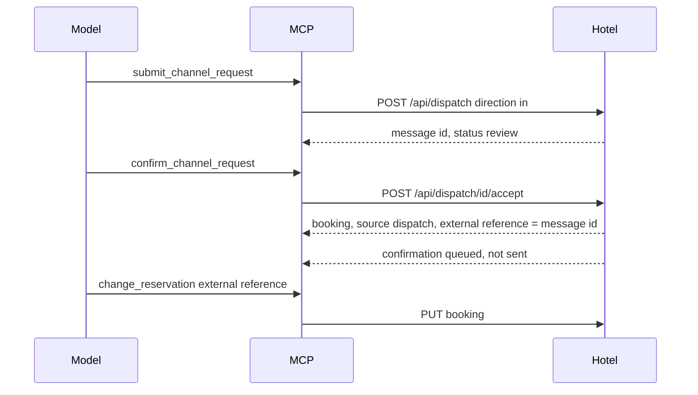
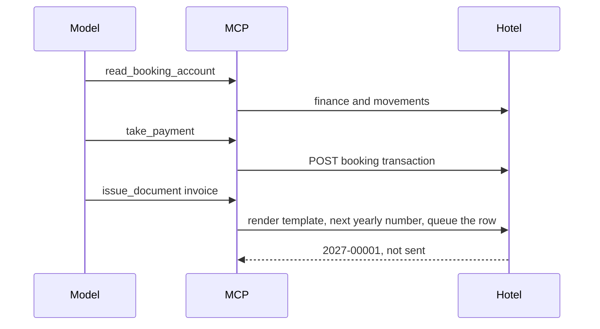
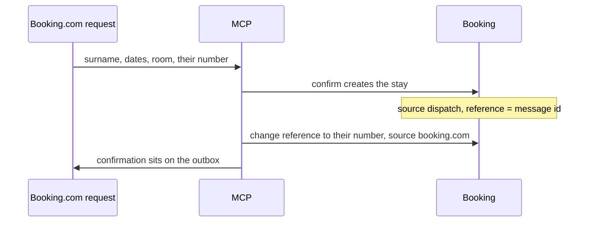

# HotelDruid MCP

One Model Context Protocol server is the desk an LLM uses. It searches the hotel, takes and changes stays, accepts an outside booking, records guests, and posts the money. The hotel API remains the system of record. The server does not keep a second copy of the rooms or the ledger.

The tools live in the API project, under `src/HotelDruid.Api/Mcp`. A separate executable would be a second instance, with its own port and its own place to point at the data. The hotel already has a process. The MCP endpoint is mounted on that process.

## What you can ask

The tools speak MCP revision 2025-06-18 as implemented by the C# SDK 2.4: tools with JSON Schema and annotations, resources, resource templates, prompts, structured tool results, and server instructions. The endpoint uses streamable HTTP from the 2025-11-25 transport.

The desk tools are part of the hotel API, at `https://localhost:5001/mcp`.

The hotel must be running. The endpoint is the same port as the desk.

## How a call moves

The model is told, in the server instructions, to search before it creates, to speak rooms by name, and not to sign a night unless a person named that date and asked to close it. Each tool reply is a short record: whether it worked, one sentence, the ids and figures, and the sensible next tool. Lists stop at 20 or 40 rows and say how many were left out.

## Why it is not one tool per API route

The hotel API has well over a hundred routes. Putting each route in front of a model makes discovery worse: the model has to know which of `/api/bookings`, `/api/bookings/stays`, and `/api/bookings/arrivals` answers "who is arriving". MCP guidance is the opposite. A tool is a task a clerk would name, with a description of when to use it and what it must not be used for.

These were the cuts.

| Choice | Why | What it changes |
| --- | --- | --- |
| Call the hotel's own HTTP API | The posting rules, the invoice series, and the night-audit checks stay in one place. The tools are a desk vocabulary over that API, not a second store | A tool call on `/mcp` calls back into the same process on its public URL. `HotelDruid:Api` or `HOTELDRUID_API` can point that callback elsewhere. The default is `https://127.0.0.1:5001` |
| 34 task tools | A model can scan the list. A REST mirror cannot | A new API field is invisible until a tool is taught to send it |
| Room name in, store id inside | Clerks and models say "101". The store key is a 26-character id | "101" and the store id both work. A name that is not a room is rejected |
| Source and external reference | An OTA or a partner hotel is a stay with a who and a their-number. There is no connector catalog | Confirming an inbox request sets source `dispatch` and the external reference to the message id. Their own number is then written with `change_reservation` |
| The hotel queues, it does not send | No mailbox password and no channel token live in the hotel | `issue_document` and `queue_message` leave a row. `mark_message_relayed` is only for after a real send |
| Ambiguous guests stop the call | Two people can share a surname | `create_reservation` lists the matches and does not pick one |
| `sign_night` needs `confirm`, a desk name, and a date that is not in the future | Signing means the day was seen, not that it was paid | A model cannot close today by accident. The hotel still refuses a future date |
| Inbox automation is its own switch | Unattended booking creation stays off until someone turns it on | `process_channel_inbox` does nothing useful until `set_message_automation` is true. Confirming one request does not need that switch |
| `openWorld` is false | The server talks only to this hotel | Clients can treat the tools as a closed system |
| Read tools are `readOnly` and `idempotent`. Cancel, no-show, refund, sign, and the automation switch are `destructive` | Clients can ask before running a destructive tool | A refund or a cancellation still happens if the model calls it. The description says to do that only when a person asked |

Annotations use the MCP names `readOnlyHint`, `destructiveHint`, `idempotentHint`, and `openWorldHint`. The SDK sets them from `ReadOnly`, `Destructive`, `Idempotent`, and `OpenWorld`. Tool results use structured content so the next call can take an id without parsing prose.

## Resources and prompts

Resources are for reading without a tool call.

| URI | What it is |
| --- | --- |
| `hotel://guide` | The operating rules, in a few sentences |
| `hotel://desk/today` | Arrivals, in house, departures, waiting requests, registration gaps |
| `hotel://rooms` | Name, id, capacity, floor, condition |
| `hotel://accounts` | Chart code, name, and role |
| `hotel://booking/{id}` | One stay, its account, and the people on it |
| `hotel://guest/{id}` | One guest record |

Prompts are the scripts. They tell the model which tools to call and where to stop.

| Prompt | What it makes the model do |
| --- | --- |
| `front_desk_morning` | Read today. Change nothing |
| `take_a_reservation` | Find a free room, then create the stay, then read the price |
| `accept_an_ota_booking` | Check the room, submit the request, confirm it, store their number |
| `guest_details` | Save the copied document fields and attach an extra person. No scan |
| `take_payment_and_invoice` | Read the amount due, take the money, queue the invoice |
| `record_a_purchase` | Post a purchase, then show the ledger lines |
| `close_a_business_day` | Read the night, the guest file, and the cashier sheet. Sign only if the person already asked |

## Tools

### Find

- `search_hotel` finds a surname, a room name, a booking id, or an external reference.
- `read_desk` is one date: arriving, in house, leaving, inbox rows still waiting, registration gaps.
- `find_availability` lists free rooms and can quote one. Departure morning is free for the next arrival. A maintenance room is not free.

### Stay

- `read_booking` is the stay, the account, and the attached guests.
- `create_reservation` reuses one matching guest or creates one. It refuses a room that is taken or too small.
- `change_reservation` patches dates, notes, source, external reference, and the room of a stay that is not yet in house. A guest already in house moves with `move_room`.
- `check_in`, `check_out`, `move_room`, `cancel_reservation`, `mark_no_show`.

`move_room` splits the stay on the move night and splits the price. At least one night stays in each room.

### Guest

- `read_guest` and `save_guest` hold the fields the clerk copies from the document: name, contact, birth, nationality, document, address, codice fiscale, VAT. A scan is not a field.
- `attach_guest` adds another named person to the stay. `coveredByLead` is for a child or group member the standard allows on the lead's card. Card state is `printed`, `checked`, or `filed`.

### Outside bookings and messages

- `submit_channel_request` stores the surname, dates, room, and guest count. The room name is turned into the store id before it is saved. This does not create the stay.
- `confirm_channel_request` creates the guest and the confirmed stay, sets source `dispatch`, and queues a confirmation.
- `list_messages` reads the inbox and the outbox.
- `process_channel_inbox` runs the unattended pass. It creates stays only when automation is on.
- `queue_message` puts an inline email, WhatsApp, SMS, or post row on the outbox. Email does not carry an attachment.
- `mark_message_relayed` writes the time a tool actually handed the message to a channel.

### Money

- `read_booking_account` is the price, payments, deposits, refunds, and the amount due.
- `take_payment` is `payment` against the stay, or `deposit` held until checkout.
- `refund_payment` sends money back. It is marked destructive.
- `sell_at_desk` charges an in-house stay, or takes walk-up cash when no booking is passed. A stay sale is only after check-in.
- `record_expense` is a purchase: operating expense against cash. It is the purchase list.
- `record_drawer` is petty cash that is not a guest payment and not that purchase. Direction `in` is other income. Direction `out` is cash spent. A guest payment does not belong here.
- `issue_document` renders `invoice`, `rechnung`, `receipt`, or `confirmation` and queues it. An invoice takes the next number in that year, printed as `2027-00001`. A later issue of the same stay reuses it.
- `read_ledger` reads the general ledger for a date range, or one booking. Hotel cash has an empty booking id. At most 40 lines come back.

### Administration

- `read_hotel` is the name, currency, tax, chart, registration standard, automation flag, and whether Keycloak is the front.
- `read_registration` is the guest-file gaps for a date.
- `read_night` is one business day. It does not sign it.
- `read_report` is a desk or manager sheet: `arrivals`, `in-house`, `departures`, `room-status`, `room-board`, `cashier`, `flash`, `forecast`, `balances`, `performance`, `tax`, `statistics`.
- `set_message_automation` flips that one flag and writes the rest of the configuration back unchanged.
- `sign_night` records that the desk saw the day. The caller passes `confirm` true, the desk name, and the three checks. The name is sent as `X-HotelDruid-Desk-User`. The hotel rejects a future date and rejects a signature with no name.

What is deliberately not a tool: deleting a room, wiping configuration, importing a package, and opening an `.eml` in Outlook. Those stay on the desk program.

## Scenarios that were run

Two automated scenarios run against a throwaway hotel, so they do not touch Hotel Belvedere. `dotnet test tests/HotelDruid.Mcp.Tests -c Release --filter FullyQualifiedName~HotelScenarios`.

A third probe ran once against the hotel that is already running. It does not run unless `HOTELDRUID_MCP_LIVE=1`. It did not sign a night, did not move Sem de Vries, and did not touch the Schneider party.

### A phone reservation

Isolated hotel, rooms 901–903. Nora Adler, room 901, 16–18 March 2027, source `phone`, two guests. Lars Adler was attached as guest 2. A passport number and Lugano were saved on Nora. A payment of 40 was posted. The invoice template queued an invoice in the 2027 series.

On the live hotel the same steps used the first free room, which was 101, for Mara Quill, 10–12 March 2027, source `phone`. Booking `6nkhwjykhuvehfp37mt6yasoga`. No tariff is assigned to that room for those dates, so the stay posted city tax only, 4.50. A payment of 25 then left a credit: amount due −20.50. Invoice `2027-00001` was issued and queued. The next 2027 invoice will be `2027-00002`. Sem de Vries remains in 101 through 17 November 2026. The March stay does not overlap that.

### An outside booking

Isolated hotel: Ida Berg, room 902, 1–3 June 2027, channel `booking.com`, their number `BDC-900`. Confirm created the stay. The external reference was then set to `BDC-900` and the source to `booking.com`. The confirmation was on the outbox, unsent.

Live hotel: the same shape on room 102, 8–10 September 2027. Booking `njz4slhjp5fezmirvxedhxjgmu`. Subject carried `BDC-LIVE-1`, then `change_reservation` stored that number and source `booking.com`.

### Money that is not a guest payment

On the isolated hotel, an expense of 18.50 for linen on 16 March 2027 posted operating expense against cash. A drawer float of 5 posted other income. A walk-up coffee of 4 posted a cash sale. The ledger for that date contained the purchase.

A guest payment is `take_payment`. A purchase is `record_expense`. The drawer is only the cash that is neither of those.

### In house, a move, a cancel, a no-show

On the isolated hotel: Eva Haus checked in to 902 on 1 May 2027 and checked out on 3 May. Otto Keller moved from 901 to 903 on the night of 2 April 2027. Una Frei was cancelled. Pia Nacht was a no-show, with a note. None of these ran on the live hotel.

### The night and the guest file

`read_night` and `read_registration` were read. `sign_night` with `confirm` false did not sign. Signing 15 January 2026 on the isolated hotel, with a desk name, recorded the day as seen. The live night of 16 November 2026 was not signed. A future date is refused by the hotel. Automation was turned on and then off again on the isolated hotel only. The live hotel's automation switch was not changed.

### Discovery through the protocol

A second test started the MCP HTTP server and connected with the MCP client, not by calling the C# methods directly. It listed the tools, the `accept_an_ota_booking` prompt, and `hotel://guide`, then called `search_hotel` for room 901.

## What this does not do

The server does not talk to Booking.com, email, WhatsApp, or a police portal. An outside booking arrives because something posts it, or because the model calls `submit_channel_request`. A message leaves the building only when some other tool sends the queued row and calls `mark_message_relayed`.

A stay with no tariff still accepts a payment. That payment can leave a credit, which is what happened for Mara Quill. Quote the room with `find_availability` before taking money when the dates are outside the seasons on the tariff.

Search of external references scans one arrival year. Guest search is by surname. A very large year still returns at most 20 matches.
